<div align="center">

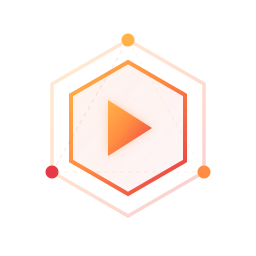

# RunR

**Open-source serverless platform on your own Kubernetes.**<br>
Functions, containers and WebAssembly with scale-to-zero on Knative, on clusters you operate - bare metal, private cloud, managed Kubernetes, connected or air-gapped.<br>
Every change is a version you can deploy, compare and roll back. Blue-green and canary, environments, event triggers, durable workflows, sandboxes for AI agents, GPU and Hugging Face models, MCP, RBAC, SSO, audit log, supply chain.

[](#quick-start)
[](https://runr.sh/docs/)
[](https://runr.sh)

[](https://github.com/BRF-Tech/runr/releases)
[](LICENSE)
[](https://github.com/BRF-Tech/runr/actions/workflows/ci.yml)
[](#kubernetes-helm)
[](https://registry.terraform.io/providers/brf-tech/runr/latest)
[](https://pkg.go.dev/github.com/brf-tech/runr/cli)

**English** · [Türkçe](README.tr.md)

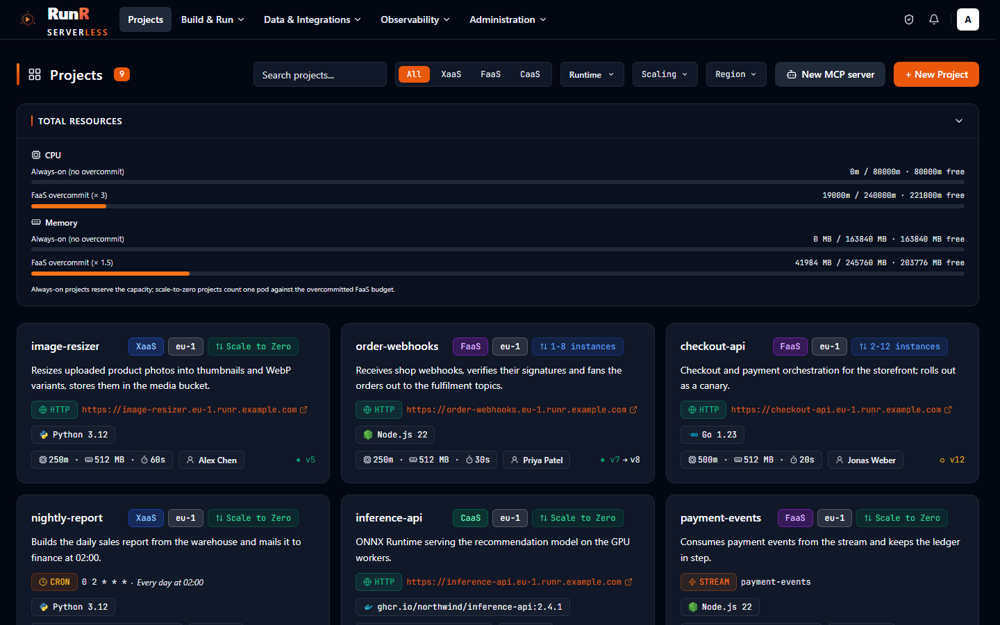

</div>

<table>
<tr>
<td width="50%" valign="top">

**⚡ Functions, containers and WebAssembly**

A single-file function in the browser, a multi-file project built in the cluster, any container image, or a Wasm component - on the same clusters, with scale-to-zero. Every language is a runtime plugin.

[Functions, containers and WebAssembly →](#functions-containers-and-webassembly)

</td>
<td width="50%" valign="top">

**🚀 Deploy strategies and environments**

Every change is a version. Blue-green and canary rollouts with automatic rollback, dev / staging / production with promotion and approval, `git push` and a preview per pull request.

[Deploy strategies and environments →](#deploy-strategies-and-environments)

</td>
</tr>
<tr>
<td width="50%" valign="top">

**🔔 Event triggers and durable workflows**

HTTP, schedules, queues, webhooks, topics, Kafka, NATS, RabbitMQ, MQTT, Postgres CDC, S3 and e-mail on one trigger list, with retries and dead letters. Workflows whose progress survives crashes and sleeps of days.

[Triggers, data and durable workflows →](#triggers-data-and-durable-workflows)

</td>
<td width="50%" valign="top">

**🧪 Sandboxes for AI agents**

Short-lived, isolated sandboxes for the code an agent writes - exec, files, background processes, a code interpreter, warm pools - under gVisor or Kata Containers micro-VMs, on your own cluster.

[Sandboxes for AI agents →](#sandboxes-for-ai-agents)

</td>
</tr>
<tr>
<td width="50%" valign="top">

**🧠 GPU, Hugging Face models and MCP**

GPU functions and containers that scale to zero, one-click model services online or fully offline, a built-in MCP server for agents such as Claude Code, and hosting for MCP servers of your own.

[GPU, Hugging Face models and MCP →](#gpu-hugging-face-models-and-mcp)

</td>
<td width="50%" valign="top">

**🔐 Security and enterprise**

One permission catalog with built-in and custom roles, SSO with group mapping, an append-only audit log, secrets that never leave the region, SBOMs, scans, signatures and a policy gate.

[Security and enterprise →](#security-and-enterprise)

</td>
</tr>
</table>

<p align="center"><a href="#why-runr">Why RunR</a> · <a href="#coming-from-knative-openfaas-aws-lambda-or-vercel">Coming from another platform</a> · <a href="#regions-and-operations">Regions and operations</a> · <a href="#measured-cold-starts">Measured cold starts</a> · <a href="#architecture">Architecture</a></p>

<br>

# Quick start

RunR is software you install, not a hosted service. The control plane runs on Kubernetes (Helm) or
on one machine (Docker Compose); every **region** that runs your functions is a Kubernetes cluster
you register with its kubeconfig.

## Kubernetes (Helm)

The chart `runr` is in BRF's public Helm repository; no credentials are needed, and `domain` is the
only required value:

```bash
helm repo add brf-tech https://helm.brf.sh
helm upgrade --install runr brf-tech/runr --namespace runr --create-namespace --set domain=runr.example.com
helm status runr -n runr      # prints how to read the first administrator's password
```

The chart installs the gateway, UI, API, Horizon, scheduler and Reverb and - unless you point it at
external services - PostgreSQL, Redis and Mailpit, with migration and bootstrap hooks that create the
first administrator. To install a specific release, pin the chart version (`--version 0.6.12`); the
API and UI images follow it. `edition=multi-tenant` switches on the Tenancy and Auth Provider
modules and the multi-tenant console image.

<details>
<summary><b>Production values, upgrades and the first region</b></summary>

- Every value, its default and what the chart validates: `helm show values brf-tech/runr` and
  [docs/helm-values.md](docs/helm-values.md).
- A production install - external PostgreSQL and Redis, TLS, replicas, network policies, backups:
  [docs/install.md](docs/install.md). Existing installations upgrade in place with `helm upgrade`:
  [docs/upgrade.md](docs/upgrade.md).
- The first region: open **Administration → Regions & settings → Knative Regions → + Add Region**,
  upload the cluster's kubeconfig and let RunR install Knative Serving and the region components
  ([docs/regions.md](docs/regions.md)). For a laptop, `bash compose/kind-setup.sh` creates a kind
  cluster with cloud-provider-kind and writes `compose/runr-kubeconfig.yaml`.

</details>

## Single host (Docker Compose)

[compose/README.md](compose/README.md) installs the control plane with prebuilt images on one
machine, including air-gapped hosts: modules, the first administrator, HTTPS through a Caddy on the
host, updates.

<details>
<summary><b>Local development stack</b> - the source checkout, built and started</summary>

Requirements: Docker with the Compose plugin.

```bash
git clone https://github.com/brf-tech/runr.git
cd runr
bash scripts/devready.sh docker
```

The script creates `.env`, generates the application key, builds and starts the stack and runs the
migrations and seeders. Open the console at <http://localhost:8061> (API on port 8060) and sign in
as `admin` (or `admin@example.com`) with the `ADMIN_PASSWORD` from `api/.env.docker`. Details:
[docs/development.md](docs/development.md).

</details>

## Your first deployment from the CLI

```bash
curl -fsSL https://runr.sh/install.sh | sh      # Linux, macOS; other platforms: https://runr.sh/dl/
runr login https://runr.example.com
runr init hello --runtime python
cd hello
runr dev          # http://localhost:8080 on the same runtime image, restarts on every change
runr deploy       # builds, deploys and prints the URL
```

`runr` scaffolds, runs locally, deploys and operates every RunR feature from a terminal or CI
([docs/cli.md](docs/cli.md)). The same operations are available as a
[Terraform provider](docs/terraform.md), a [GitHub Action](docs/github-action.md) and
[MCP tools](docs/mcp.md).

<br>

# Why RunR

Teams that want serverless on their own infrastructure usually land between two options. Knative
gives you the primitives - request-driven autoscaling, scale to zero, revisions, traffic splitting -
as Kubernetes resources, and leaves the build pipeline, the console, the users, the policy and the
day-two operations to you. The hosted function clouds give you all of that, on their
infrastructure, under their quotas and their terms. RunR is the platform in between: install it on
the clusters you already run and get the hosted experience - an editor, `git push`, versions,
environments, triggers, a team with roles - while your code, your data and your secrets stay where
you put them.

- **Yours.** The control plane and every region run on infrastructure you operate: bare metal, a
  private cloud or managed Kubernetes, connected or air-gapped. There is no per-request fee; the
  cost is your cluster's. MIT licensed.
- **Every change is a version.** Code and configuration changes become versions backed by a
  per-project git repository; deploy any ready version, watch the rollout live, roll back with the
  configuration it ran with ([versions](docs/versioning.md)).
- **Serverless for more than functions.** Containers, WebAssembly, GPU workloads, model services,
  durable workflows and agent sandboxes scale to zero on the same clusters and under the same
  roles, triggers and audit log as a function.

The tour below has seven parts, each with its screenshot and the page that documents it in full.
Every claim is backed by a page in [`docs/`](docs/README.md); what changed in each release is in
[CHANGELOG.md](CHANGELOG.md).

<br>

# Coming from Knative, OpenFaaS, AWS Lambda or Vercel

| Coming from | With RunR |
|---|---|
| **Knative Serving**<br>The Kubernetes building blocks: request-driven autoscaling, scale to zero, revisions and traffic splitting as Kubernetes resources, written as YAML. You bring the build, the images, the console, the users and the policy. | RunR installs Knative Serving, Traefik, a registry, Redis, Prometheus and Loki in every region and keeps them up to date ([regions](docs/regions.md)). On top: builds in the cluster, a `git push` remote per project, an editor, versions with rollback, triggers, environments, RBAC, SSO and an audit log. Nobody writes a Knative Service by hand. |
| **Knative Functions (`func`)**<br>A CLI that builds a function from a language template into a container image with Buildpacks or S2I and deploys it as a Knative Service. | `runr init`, `runr dev` and `runr deploy` do the same from a terminal, on the same runtime images the cluster uses ([CLI](docs/cli.md)) - and every deploy is a version in a control plane with a console, environments, triggers, team access and observability. Python, Node.js, Go, PHP, Java, .NET (C#), Ruby, TypeScript (Bun), PyTorch and TensorFlow ship built in; any language is a `runtime.yaml` plugin ([runtimes](docs/runtimes.md)). |
| **OpenFaaS**<br>Functions built from `faas-cli` templates into container images and deployed behind a gateway on Kubernetes; a Community Edition and commercial editions. | Three project types on one platform: a single-file function edited in the console, a multi-file project built in the cluster, and any container image ([architecture](docs/architecture.md#project-types)). One trigger list per project - HTTP, schedules, queues, webhooks, topics, brokers, CDC, S3, e-mail ([triggers](docs/triggers.md)). Single-tenant and multi-tenant editions of the same MIT-licensed code. |
| **AWS Lambda**<br>A hosted function service: your code runs in the provider's regions, in managed runtimes or a container image, billed per request and per GB-second. | The same scale-to-zero functions - and long-running containers, WebAssembly, GPU workloads and agent sandboxes - on clusters you choose, including air-gapped ones. Minimum and maximum scale and a timed warmer per project ([scaling](docs/scaling.md)); bindings for KV, object storage and Postgres ([bindings](docs/bindings.md)); secrets kept in the region's own store ([secret stores](docs/secret-stores.md)). |
| **Vercel**<br>A hosted platform for front-end frameworks: git integration with a preview deployment per pull request and serverless functions, on the provider's infrastructure. | The same `git push` flow on your own clusters: a remote per project or a GitHub App, GitLab or Forgejo / Gitea connection with push-to-deploy, commit statuses and a preview environment per pull or merge request with its own URL and automatic cleanup ([git deploy](docs/git-deploy.md)). Dev / staging / production with promotion and approval ([environments](docs/environments.md)), blue-green and canary ([deploy strategies](docs/deploy-strategies.md)), custom domains with certificates from cert-manager. |

<br>

# Functions, containers and WebAssembly

**From a single file to a full container, on one platform.**

- **Three project types**: XaaS (a single-file function edited in the built-in Monaco editor), FaaS
  (a multi-file project with dependencies, built in the cluster when needed) and CaaS (any container
  image with port, command, arguments and environment) ([architecture](docs/architecture.md#project-types)).
- **Pluggable runtimes**: every language is a plugin - a `runtime.yaml` manifest plus an image.
  Python, Node.js, Go, PHP, Java, .NET (C#), Ruby, TypeScript (Bun), PyTorch and TensorFlow ship
  built in; platform administrators and organizations register their own (C, Rust, Bash and Q
  examples included), in `http`, `exec` or `persistent` mode behind RunR's universal wrapper
  ([runtimes](docs/runtimes.md)).
- **Runtime patches**: runtime images get immutable patch tags, and a signed feed tells every
  installation why a patch came (routine, security, critical, zero-day). Projects apply or pin a
  patch; at the deadline of a critical or zero-day patch RunR redeploys the projects still behind
  ([runtime patches](docs/runtimes.md#runtime-patches)).
- **WebAssembly**: Rust, Go (TinyGo), JavaScript / TypeScript and Python components on the Spin
  shim of runwasi, installed per region from the console, and `wasm-exec` for any WASI preview 1
  command module - C / C++, Zig, Go, a `build.sh` or an uploaded `.wasm` ([WebAssembly](docs/wasm.md)).
- **Sandboxed workloads**: map each project type of a region to runc, **gVisor** or **Kata
  Containers** (Cloud Hypervisor, QEMU, Dragonball, Firecracker); Kata is offered only on nodes
  with hardware virtualization ([Kata hypervisors](docs/kata-hypervisors.md)).
- **Scaling**: scale to zero, minimum and maximum scale, and a timed warmer that keeps containers
  warm on a weekly schedule ([scaling](docs/scaling.md)).

<p align="center">
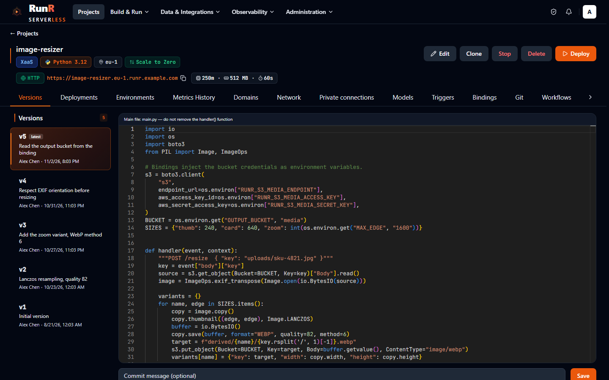
</p>
<p align="center"><sub>A single-file function in the console's editor; saving creates a version</sub></p>

<details>
<summary><b>More screenshots</b> - a project's overview</summary>

<p align="center">
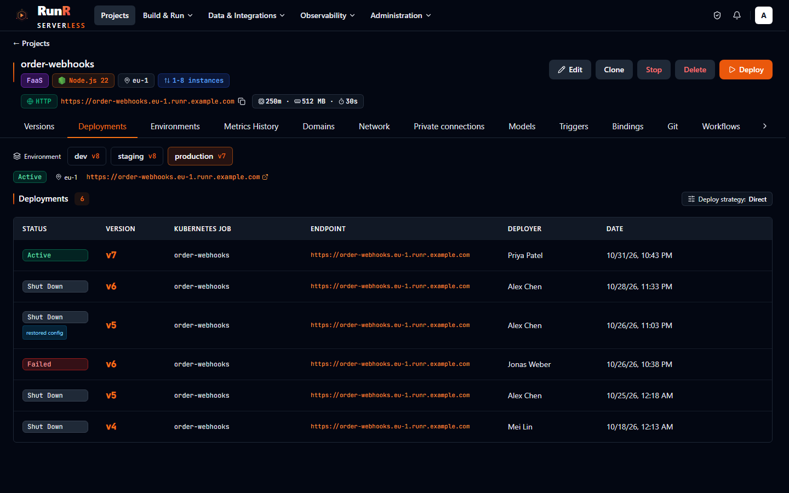
</p>
<p align="center"><sub>A project's overview: URL, triggers, the deployed version, scale and the last deployments</sub></p>

</details>

<br>

# Deploy strategies and environments

**Every change is a version. Every rollout is one you can watch, promote and undo.**

- **Versions and deployments**: every code or configuration change is a version backed by a
  per-project git repository; deploy any ready version, watch the rollout live, roll back with the
  configuration it ran with ([versioning](docs/versioning.md)).
- **Deploy strategies**: blue-green and canary rollouts per function, with test URLs, promotion
  after health checks, an automatic rollback on the new revision's error rate or latency, and the
  previous revision kept warm for an instant rollback ([deploy strategies](docs/deploy-strategies.md)).
- **Environments and promotion**: dev, staging and production of one project, with configuration
  overrides, secrets, bindings, domains and regions of their own, a git branch per environment, and
  promotion of the same image with approval ([environments](docs/environments.md)).
- **Git push and providers**: every project has its own git remote (`git push runr main`), or
  connects to a repository on GitHub (GitHub App), GitLab or Forgejo / Gitea with push-to-deploy,
  commit statuses and a **preview environment** for every pull / merge request, with its own URL,
  scale-to-zero and automatic cleanup ([git deploy](docs/git-deploy.md)).
- **From a terminal or CI**: the `runr` [CLI](docs/cli.md), the [Terraform provider](docs/terraform.md)
  for projects, variables, domains, deployments, bindings, runtimes, workflow triggers, model
  services, hosted MCP servers, access control and branding, and a [GitHub Action](docs/github-action.md)
  that deploys on push and runs preview environments for pull requests.
- **Uploads and networking**: `docker save` archives, OCI image tars and `.wasm` modules pushed
  into a region's registry in resumable chunks - also for regions without internet access
  ([uploaded images](docs/images.md)); per-project subdomains, path-based API gateways, custom
  domains with uploaded certificates or certificates from the cert-manager RunR sets up in each
  region.

<p align="center">
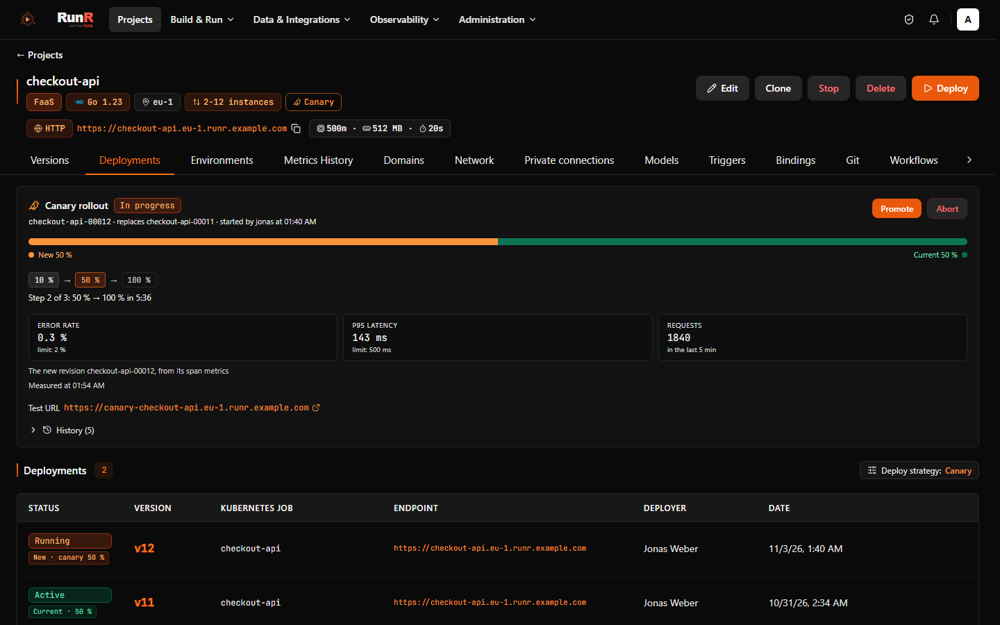
</p>
<p align="center"><sub>A rollout, live: build, image, revision, traffic</sub></p>

<details>
<summary><b>More screenshots</b> - deploy strategies, environments</summary>

<table>
<tr>
<td width="50%" valign="top">

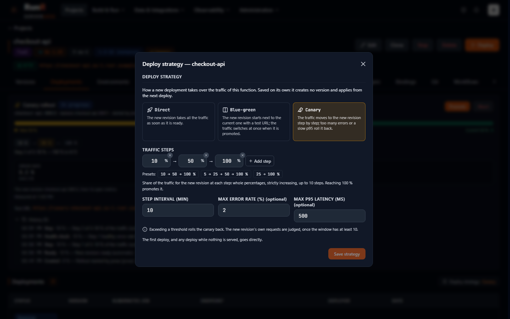

<sub>Deploy strategy: blue-green with a health check and a warm previous revision, or canary steps with error-rate and latency thresholds</sub>

</td>
<td width="50%" valign="top">

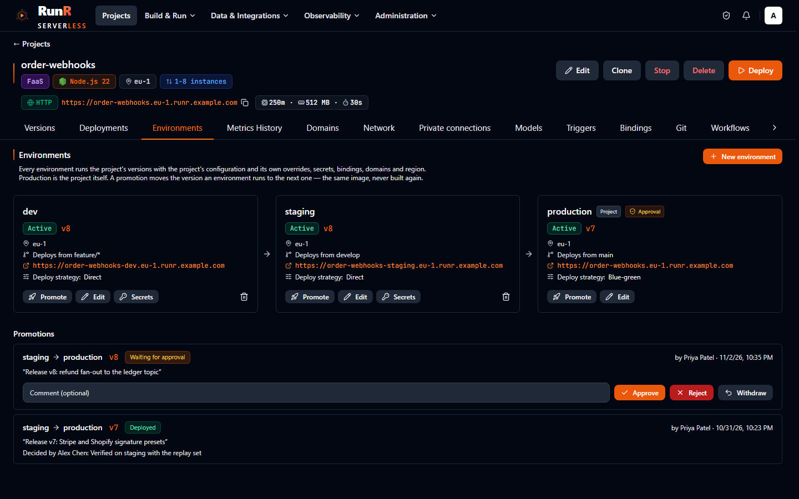

<sub>Environments: dev, staging and production, the version each one runs, a promotion waiting for approval</sub>

</td>
</tr>
</table>

</details>

<br>

# Triggers, data and durable workflows

**Anything that happens can invoke a function, and a function can take days to finish.**

- **Triggers**: a list per project - HTTP, schedules in a time zone, queues (Redis Streams), a
  webhook inbox with signature presets and replay, fan-out topics, platform events, and broker and
  external sources (Kafka, NATS, RabbitMQ, MQTT, Postgres CDC, S3, e-mail over IMAP) - delivered by
  the project's event gateway with retries and dead letters ([triggers](docs/triggers.md)).
- **Durable workflows**: code-first, step-based functions whose progress survives crashes,
  redeploys and sleeps of days - retries, timers, events, child workflows - with Python and
  TypeScript SDKs and a run history in the console ([workflows](docs/workflows.md)).
- **Bindings**: managed KV (Redis), object storage (S3 on Garage or an external endpoint),
  Postgres (CloudNativePG) and external credentials, attached to projects and injected as
  environment variables, with rotation, retention and restore ([bindings](docs/bindings.md)).
- **Internal network**: projects of a region call each other by name, admitted by the callee's
  allow list; a project is public, public from an IP allow list, or internal only
  ([internal network](docs/internal-network.md)).
- **API product**: offer a gateway's API to others with consumers, API keys, JWT routes, plans
  with rate limits and quotas, and measured usage for your own invoicing system
  ([API product](docs/api-product.md)).

<p align="center">
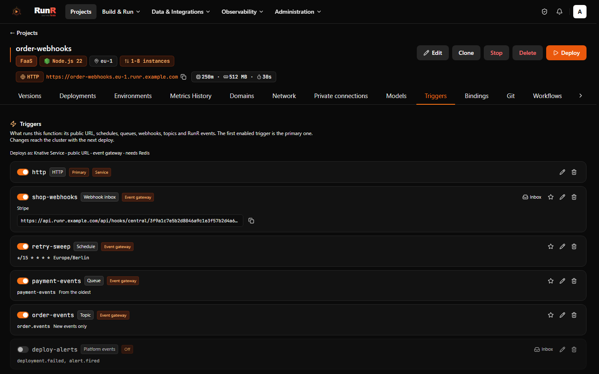
</p>
<p align="center"><sub>A project's triggers: HTTP, a schedule, a queue and a webhook inbox on one list</sub></p>

<details>
<summary><b>More screenshots</b> - a workflow run</summary>

<p align="center">
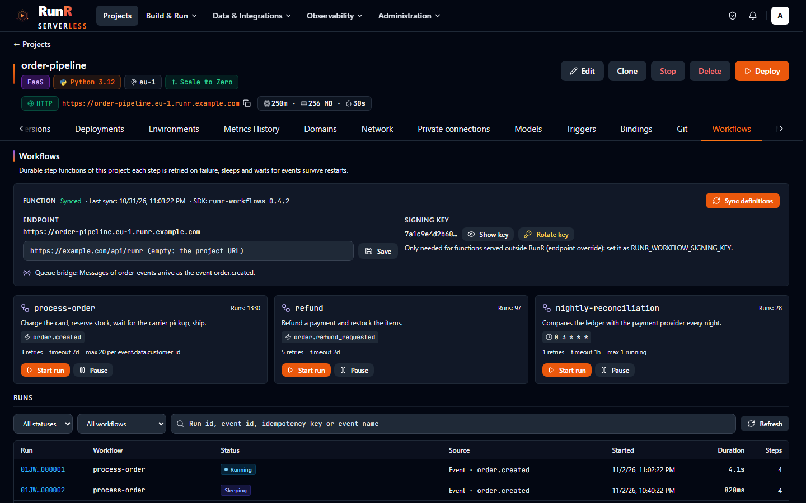
</p>
<p align="center"><sub>A durable workflow's runs: every step, its retries and the sleeps between them</sub></p>

</details>

<br>

# Sandboxes for AI agents

**The code an agent writes runs in a micro-VM on your cluster, not on the agent's host.**

- The **Sandbox API** creates isolated, short-lived sandboxes: exec, files, background processes, a
  terminal and a code interpreter, with Python and TypeScript SDKs ([Sandbox API](docs/sandbox-api.md)).
- A sandbox runs under the strongest isolation the region offers - a **Kata Containers** micro-VM
  or **gVisor** - without network access unless you allow it, as an unprivileged user with its own
  CPU, memory, disk and process limits ([security model](docs/sandbox-api.md#security-model)).
- **Warm pools** hand out a ready sandbox in a fraction of a second; quotas and metering per
  organization keep the use in bounds ([warm pool](docs/sandbox-api.md#warm-pool)).
- Agents reach sandboxes through the SDKs, the REST API or the MCP tools of the RunR MCP server
  ([MCP tools](docs/sandbox-api.md#mcp-tools)).

<p align="center">
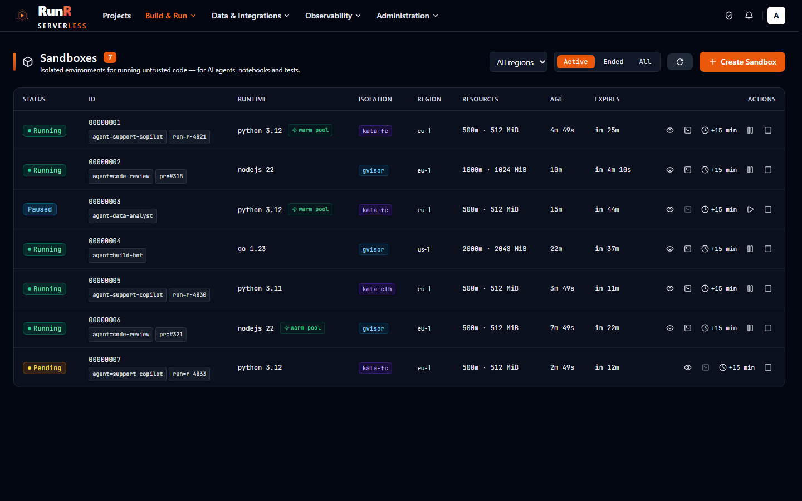
</p>
<p align="center"><sub>A sandbox: its runtime class, limits, processes and the commands it ran</sub></p>

<br>

# GPU, Hugging Face models and MCP

**Models and the code that uses them, serverless, on your own GPUs.**

- **GPU workers**: RunR detects NVIDIA GPU nodes, installs the device plugin or GPU Operator and
  schedules GPU functions and containers there, scaling to zero and metered by GPU time; GPU CaaS
  runs any image with a GPU count, product and memory requirement ([AI](docs/ai.md)).
- **Hugging Face models**: one-click model services (vLLM, TGI, TEI, `hf-serve` or your own image)
  online or fully offline, a playground, and model bindings for functions in any language; regions
  without internet access get their models by upload or import ([Hugging Face](docs/huggingface.md)).
- **MCP server**: a built-in Model Context Protocol server at `/mcp` lets agents such as Claude
  Code operate RunR within the permissions of their token, with one-click OAuth 2.1 ([MCP](docs/mcp.md)).
- **MCP hosting**: your own MCP servers - Python and TypeScript starters or any image - run as
  projects behind a gateway with public, token or OAuth access, a call log and an inspector
  ([hosting MCP servers](docs/mcp.md#hosting-mcp-servers)).

<p align="center">
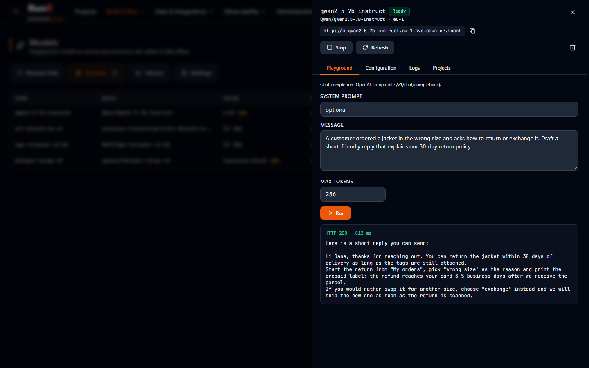
</p>
<p align="center"><sub>A model from the Hugging Face Hub, deployed as a model service with its engine, mode and GPU</sub></p>

<details>
<summary><b>More screenshots</b> - the MCP server</summary>

<p align="center">
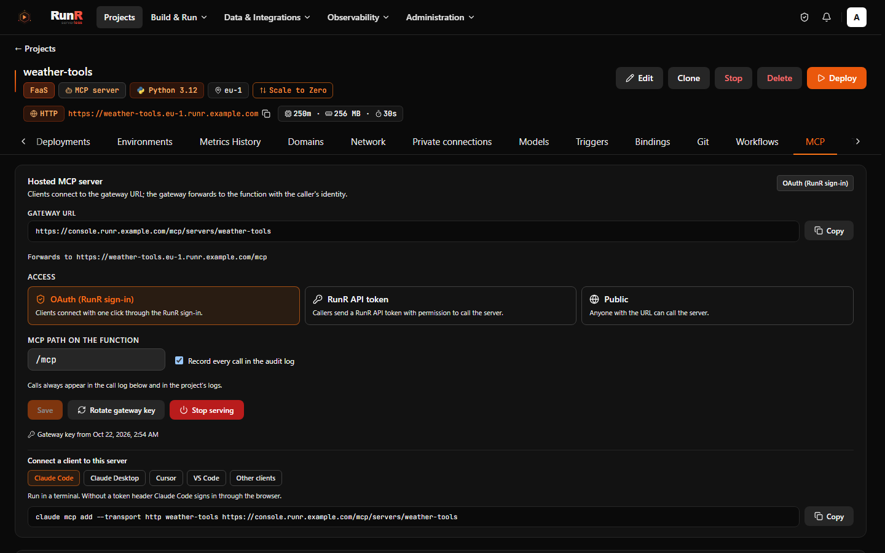
</p>
<p align="center"><sub>MCP: the clients connected to RunR's own server and the MCP servers hosted as projects</sub></p>

</details>

<br>

# Security and enterprise

**One permission catalog, secrets that stay in the region, and an image policy before anything runs.**

- **RBAC**: one permission catalog, built-in and custom roles, groups, per-project access and
  scoped API tokens ([permissions](docs/permissions.md)).
- **SSO**: Google, GitHub, Microsoft, GitLab, OpenID Connect and SAML 2.0, with SSO group mapping
  to roles; optional two-factor authentication ([modules](docs/modules.md)).
- **Audit log**: an append-only record of sign-ins, changes, deploys, shell sessions and denials,
  with export and SIEM forwarding ([security](docs/security.md#audit-log)).
- **Secrets at rest**: every stored secret is encrypted with key rotation. The values of secret
  environment variables are not stored by RunR at all: they go straight into the region's
  Kubernetes Secrets or an OpenBao RunR runs in the region, or stay in your own Vault / OpenBao,
  AWS, GCP or Azure secret store, read in the region with the region's identity
  ([secret stores](docs/secret-stores.md)); Postgres bindings can get short-lived users of their own
  ([dynamic credentials](docs/bindings.md#dynamic-credentials)).
- **Supply chain**: SBOMs, vulnerability scans (also offline), cosign signatures, a policy gate
  before deploy and signed-image admission in the region; organizations pinned to allowed regions
  and data locations ([supply chain and data residency](docs/supply-chain.md)).

<p align="center">
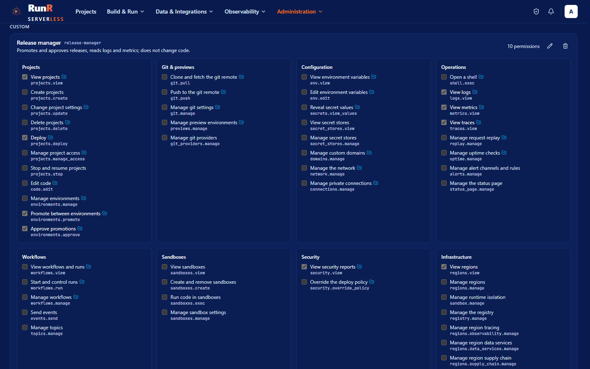
</p>
<p align="center"><sub>Roles: the built-in roles, a custom one and the permissions each one carries</sub></p>

<details>
<summary><b>More screenshots</b> - the supply chain of an image</summary>

<p align="center">
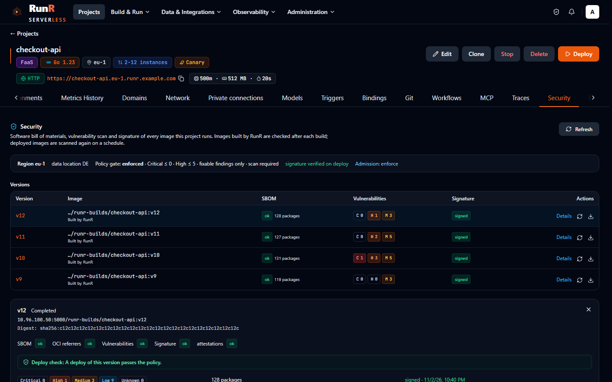
</p>
<p align="center"><sub>Supply chain: the SBOM, the scan result, the signature and the policy gate of a deployment</sub></p>

</details>

<br>

# Regions and operations

**Any Kubernetes cluster becomes a region; one project can run in several of them.**

- **Multi-region**: register any Kubernetes cluster as a region; RunR installs Knative Serving,
  Traefik, an in-cluster Zot registry, Redis, Prometheus, Loki and its region agent, keeps them up
  to date with `region:reconcile` and migrates a region to a new cluster ([regions](docs/regions.md)).
- **Global projects**: one project in several regions behind one host name, in HA or proximity
  mode, with health checks, switchover and failover, and Postgres replicas across the regions
  ([global projects](docs/global-projects.md)).
- **Observability**: metrics and logs per project, OpenTelemetry tracing with Tempo, request
  replay, uptime checks, public status pages and alerting ([observability](docs/observability.md));
  k6 **load tests** from inside the region ([load tests](docs/load-test.md)); **rightsizing** from
  what a project's pods really used ([rightsizing](docs/monitoring.md#rightsizing)).
- **Live console**: real-time updates over WebSockets, a browser shell into running pods, guided
  tours, English and Turkish ([browser shell](docs/web-shell.md)).
- **Multi-tenant edition**: one PostgreSQL schema per tenant, per-region quotas, platform regions
  shared with tenants that resell them with a markup ([tenancy](docs/tenancy.md)); optional
  **billing** in both editions with region prices, one bill per project and month and a billing API
  for your own invoicing system ([billing](docs/billing.md)); **white-label** branding, self-service
  signup and onboarding ([white-label](docs/white-label.md)); support tickets with attachments.
- **Organization export and import**: an organization packed into one versioned file and imported
  into another organization or installation ([export and import](docs/org-export.md)).

<p align="center">
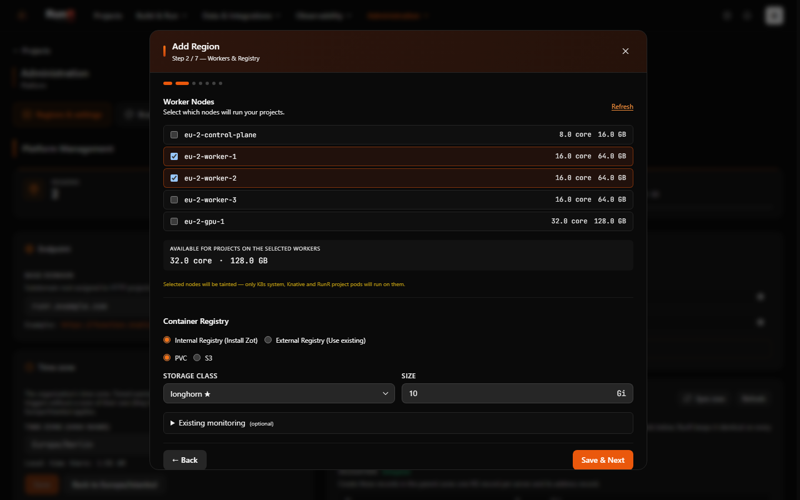
</p>
<p align="center"><sub>Adding a region: upload a kubeconfig and RunR installs Knative Serving and the region components</sub></p>

<details>
<summary><b>More screenshots</b> - logs and metrics, a global project</summary>

<table>
<tr>
<td width="50%" valign="top">

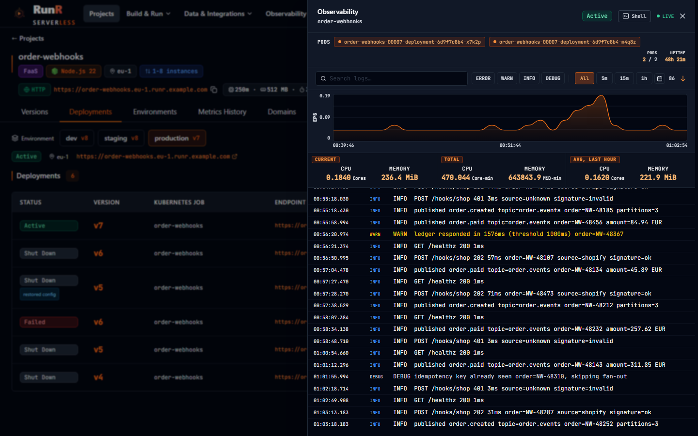

<sub>Logs and metrics of a project: requests, latency, pods, cold starts and the log stream</sub>

</td>
<td width="50%" valign="top">

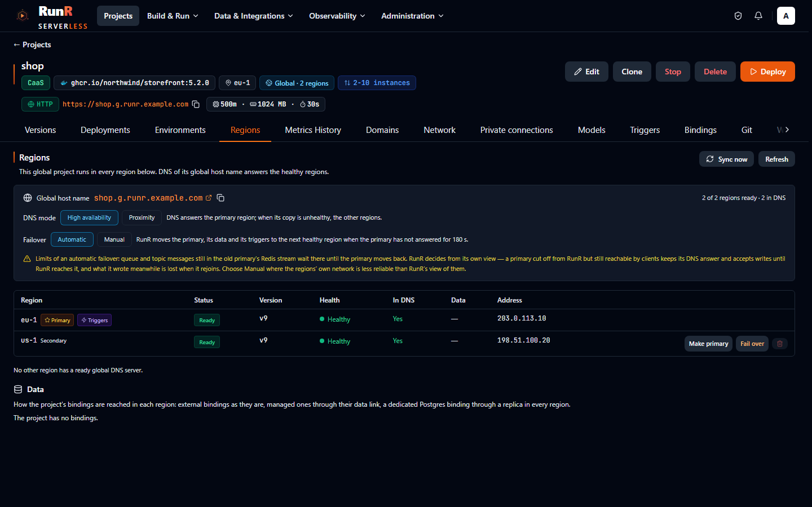

<sub>A global project: its regions, the primary, the health of every copy and the failover history</sub>

</td>
</tr>
</table>

</details>

<br>

# Measured cold starts

Measured on RunR 0.5.0, 2026-10-15: single-node k3s v1.34.11 on a test VM (8 vCPU Broadwell,
nested KVM, 15.6 GiB), Knative 1.21.3, gVisor 20260921.0; function 250m CPU / 256 MiB (container
500m / 512 MiB, WebAssembly 250m / 128 MiB), image on the node, RunR's default scale-to-zero;
HTTPS from inside the VM through Traefik, a new connection per request. The Kata Containers rows
were measured again on RunR 0.6.6 with Kata Containers 4.3.1, 2026-11-06, on the same VM in the
same way, with Python 3.15 (RunR 0.6.6's default; the 0.5.0 Python rows ran Python 3.14). Cold
start: from zero replicas to the first full HTTPS response, median (p90), n=12 each. Warm request:
median of 100 requests.

| Sandbox runtime | Function | Cold start | Warm request |
| --- | --- | --- | --- |
| runc | Python | 1.50 s (2.14) | 9 ms |
| runc | Node.js | 1.62 s (2.21) | 9 ms |
| runc | Go | 1.54 s (1.87) | 9 ms |
| runc | PHP | 1.65 s (2.48) | 9 ms |
| runc | Container image (CaaS) | 1.57 s (2.02) | 9 ms |
| gVisor | Python | 1.97 s (2.64) | 12 ms |
| Kata Containers 4.3.1 + Cloud Hypervisor | Python | 3.19 s (3.53) | 12 ms |
| Kata Containers 4.3.1 + Firecracker | Python | 3.17 s (3.52) | 11 ms |
| Kata Containers 4.3.1 + QEMU | Python | 3.96 s (4.21) | 11 ms |
| Kata Containers 4.3.1 + Dragonball | Python | 4.15 s (4.48) | 12 ms |
| WebAssembly (Spin shim) | Rust | 1.54 s (1.84) | 9 ms |
| WebAssembly (Spin shim) | JavaScript | 2.12 s (2.58) | 11 ms |

Kata was measured with Python only; Firecracker's root filesystem is on containerd's devmapper
snapshotter. Sandbox API, create to first command (RunR 0.6.8, 2026-11-08, Kata Containers 4.3.1,
the same VM; Python 3.15, 500m / 512 MiB, median (p90), n=10 per class): cold 1.89 s (2.61) under
gVisor, 3.11 s (3.43) under Kata Cloud Hypervisor and 3.57 s (3.84) under Kata Firecracker;
0.25–0.43 s from a warm pool of 2; a command in a running sandbox 0.10–0.31 s. How the Kata cold
start was brought down, and where the remaining time goes:
[Kata hypervisors → Cold start](docs/kata-hypervisors.md#cold-start).

<br>

# Architecture

```
 Browser, CLI, MCP clients ──► runr-gateway (Caddy)
               ├─ /                  → runr-ui      Vue 3 SPA
               ├─ /api               → runr-api     Laravel 12 on Octane (FrankenPHP)
               ├─ /git               → runr-api     git smart HTTP remote of every project
               ├─ /mcp, /oauth2      → runr-api     MCP server, hosted MCP servers, OAuth 2.1
               └─ /ws                → runr-reverb  WebSockets: UI events, browser shell, region agents
             runr-horizon (queue workers) · runr-scheduler · PostgreSQL · Redis
                     │  Kubernetes API + Helm (kubeconfig)          ▲ WebSocket
                     ▼                                              │
 Region (any Kubernetes cluster)                                    │
   Knative Serving + Traefik · project Knative Services / CronJobs / queue consumers
   Zot registry · Redis · gVisor / Kata Containers / Spin shim · GPU device plugin
   Prometheus · Loki · OpenTelemetry Collector + Tempo · data services · runr-agent ─┘
```

The control plane (API, UI, workers, WebSocket server, database) manages one or more regions.
Builds, deploys, supply-chain runs and region installs run as queued jobs and report progress to
the console in real time; the agent in each region streams metrics, pod sessions and Kubernetes
events back. The full picture, component by component: [docs/architecture.md](docs/architecture.md).

<br>

# Repository layout

| Path | Contents |
| --- | --- |
| [`api/`](api) | Laravel 12 API (PHP 8.3); optional modules in `api/Modules` (AuthProvider, Tenancy, Ticket, Billing) |
| [`vue/`](vue) | Vue 3 + Vite console (Pinia, Tailwind CSS, Monaco, xterm.js) |
| [`helm/`](helm) | Helm chart `runr` for the control plane |
| [`runtime/`](runtime) | The region agent, the queue consumer, the image-upload receiver, supply-chain tools, the Spin shim, `ci.sh` and the end-to-end harness. The language runtime images, the universal wrapper and hf-serve live in [BRF-Tech/runr-runtimes](https://github.com/BRF-Tech/runr-runtimes). |
| [`cli/`](cli) | The `runr` CLI (Go) |
| [`terraform-provider-runr/`](terraform-provider-runr) | Terraform provider (Go) and its reference docs; published from [BRF-Tech/terraform-provider-runr](https://github.com/BRF-Tech/terraform-provider-runr) |
| [`actions/`](actions) | GitHub Action `actions/deploy` |
| [`sdk/`](sdk) | Workflow SDKs for Python and TypeScript, Sandbox SDKs in `sdk/sandbox` |
| [`examples/`](examples) | Runtime plugins, WebAssembly, AI, MCP server and workflow examples |
| [`proxy/`](proxy) | Sentry tunnel (Go) for the development stack |
| [`compose/`](compose) | Single-host Docker Compose installation and kind helpers |
| [`scripts/`](scripts) | Development environment setup (`devready.sh`) |
| [`ci/`](ci) | Release checks for pinned Helm charts and Knative versions, and the build of runr.sh |
| [`landing/`](landing) | Website [runr.sh](https://runr.sh) and the screenshots of this page (`landing/shots/`) |
| [`logo/`](logo) | The RunR icon and wordmark (SVG) |
| [`docs/`](docs) | Documentation |

<br>

# Documentation

The documentation is published at [runr.sh/docs](https://runr.sh/docs/) and lives in [`docs/`](docs);
the [documentation index](docs/README.md) lists every page by topic. Good first reads:
[architecture](docs/architecture.md), [production install](docs/install.md),
[regions](docs/regions.md), [runtimes](docs/runtimes.md), [CLI](docs/cli.md) and
[roles and permissions](docs/permissions.md). Changes per release are in [CHANGELOG.md](CHANGELOG.md),
and the upgrade notes of every release in [docs/upgrade.md](docs/upgrade.md).

<br>

# Contributing

Issues and pull requests are welcome; before a sizeable pull request, open an issue that says what
you are about to do. [CONTRIBUTING.md](CONTRIBUTING.md) has the development workflow, the checks a
change has to pass (`ci.yml` runs them on every pull request) and the commit conventions, and the
project follows the [Contributor Covenant](CODE_OF_CONDUCT.md). A security problem is reported
privately, as [SECURITY.md](SECURITY.md) describes.

<br>

# License

RunR is released under the [MIT License](LICENSE).
Copyright (c) 2026 BRF Teknoloji and RunR contributors.

Knative, OpenFaaS, AWS Lambda, Vercel, Hugging Face, Kubernetes and the other names of projects and
products mentioned on this page belong to other parties and are used here only to describe them.
RunR is not affiliated with, sponsored by or endorsed by any of them.
