<!-- README.md'nin çevirisi (0.6.2 sonrası vitrin yenilemesi). Kaynak İngilizce README'dir: önce onu değiştirin, sonra değişikliği buraya taşıyın. -->

<div align="center">

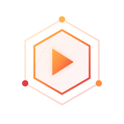

# RunR

**Kendi Kubernetes'inizde çalışan açık kaynak serverless platformu.**<br>
Fonksiyonlar, container'lar ve WebAssembly, Knative üzerinde scale-to-zero ile, sizin işlettiğiniz cluster'larda - bare metal, özel bulut, yönetilen Kubernetes, internete bağlı ya da kapalı ağ.<br>
Her değişiklik dağıtabileceğiniz, karşılaştırabileceğiniz ve geri alabileceğiniz bir sürümdür. Blue-green ve canary, ortamlar, olay tetikleyicileri, durable workflow'lar, AI ajanları için sandbox'lar, GPU ve Hugging Face modelleri, MCP, RBAC, SSO, denetim günlüğü, tedarik zinciri.

[](#hızlı-başlangıç)
[](https://runr.sh/docs/)
[](https://runr.sh)

[](https://github.com/BRF-Tech/runr/releases)
[](LICENSE)
[](https://github.com/BRF-Tech/runr/actions/workflows/ci.yml)
[](#kubernetes-helm)
[](https://registry.terraform.io/providers/brf-tech/runr/latest)
[](https://pkg.go.dev/github.com/brf-tech/runr/cli)

[English](README.md) · **Türkçe**

<sub>Bu sayfa, [İngilizce README](README.md) dosyasının çevirisidir; ikisi arasında fark olduğunda İngilizce metin geçerlidir. Bağlantı verdiği belgeler İngilizcedir.</sub>

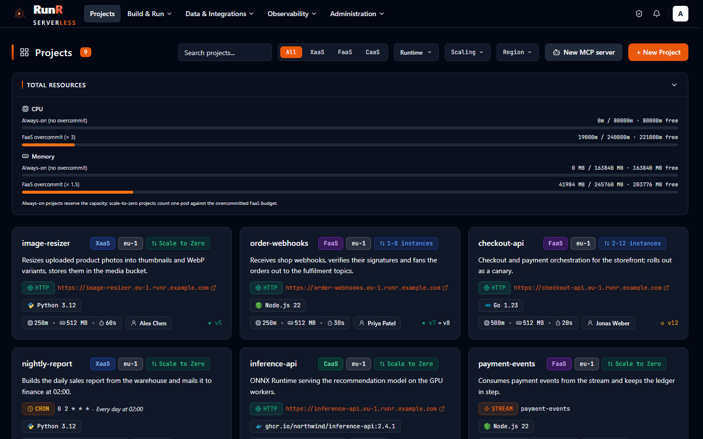

</div>

<table>
<tr>
<td width="50%" valign="top">

**⚡ Fonksiyonlar, container'lar ve WebAssembly**

Tarayıcıda tek dosyalık bir fonksiyon, cluster'da derlenen çok dosyalı bir proje, herhangi bir container imajı ya da bir Wasm bileşeni - aynı cluster'larda, scale-to-zero ile. Her dil bir runtime eklentisidir.

[Fonksiyonlar, container'lar ve WebAssembly →](#fonksiyonlar-containerlar-ve-webassembly)

</td>
<td width="50%" valign="top">

**🚀 Dağıtım stratejileri ve ortamlar**

Her değişiklik bir sürümdür. Otomatik geri almalı blue-green ve canary rollout'lar, onaylı terfi ile dev / staging / production, `git push` ve her pull request için bir önizleme.

[Dağıtım stratejileri ve ortamlar →](#dağıtım-stratejileri-ve-ortamlar)

</td>
</tr>
<tr>
<td width="50%" valign="top">

**🔔 Olay tetikleyicileri ve durable workflow'lar**

HTTP, zamanlamalar, kuyruklar, webhook'lar, topic'ler, Kafka, NATS, RabbitMQ, MQTT, Postgres CDC, S3 ve e-posta tek bir tetikleyici listesinde, yeniden deneme ve dead letter ile. İlerlemesi çökmelere ve günler süren uykulara dayanan workflow'lar.

[Tetikleyiciler, veri ve durable workflow'lar →](#tetikleyiciler-veri-ve-durable-workflowlar)

</td>
<td width="50%" valign="top">

**🧪 AI ajanları için sandbox'lar**

Bir ajanın yazdığı kod için kısa ömürlü, yalıtılmış sandbox'lar - exec, dosyalar, arka plan süreçleri, kod yorumlayıcı, sıcak havuzlar - gVisor ya da Kata Containers mikro-VM'lerinde, kendi cluster'ınızda.

[AI ajanları için sandbox'lar →](#ai-ajanları-için-sandboxlar)

</td>
</tr>
<tr>
<td width="50%" valign="top">

**🧠 GPU, Hugging Face modelleri ve MCP**

Sıfıra ölçeklenen GPU fonksiyonları ve container'ları, çevrimiçi ya da tamamen çevrimdışı tek tıkla model servisleri, Claude Code gibi ajanlar için yerleşik bir MCP sunucusu ve kendi MCP sunucularınız için barındırma.

[GPU, Hugging Face modelleri ve MCP →](#gpu-hugging-face-modelleri-ve-mcp)

</td>
<td width="50%" valign="top">

**🔐 Güvenlik ve kurumsal**

Yerleşik ve özel rollerle tek bir yetki kataloğu, grup eşlemeli SSO, yalnız eklenen bir denetim günlüğü, bölgeyi hiç terk etmeyen sırlar, SBOM'lar, taramalar, imzalar ve bir politika kapısı.

[Güvenlik ve kurumsal →](#güvenlik-ve-kurumsal)

</td>
</tr>
</table>

<p align="center"><a href="#neden-runr">Neden RunR</a> · <a href="#knative-openfaas-aws-lambda-ya-da-vercelden-geliyorsanız">Başka bir platformdan geliyorsanız</a> · <a href="#bölgeler-ve-operasyon">Bölgeler ve operasyon</a> · <a href="#ölçülen-soğuk-başlatma-süreleri">Ölçülen soğuk başlatma süreleri</a> · <a href="#mimari">Mimari</a></p>

<br>

# Hızlı başlangıç

RunR barındırılan bir hizmet değil, kurduğunuz bir yazılımdır. Kontrol düzlemi Kubernetes'te (Helm)
ya da tek bir makinede (Docker Compose) çalışır; fonksiyonlarınızı çalıştıran her **bölge**,
kubeconfig'iyle kaydettiğiniz bir Kubernetes cluster'ıdır.

## Kubernetes (Helm)

`runr` chart'ı BRF'nin herkese açık Helm deposundadır; kimlik bilgisi gerekmez ve zorunlu tek değer
`domain`'dir:

```bash
helm repo add brf-tech https://helm.brf.sh
helm upgrade --install runr brf-tech/runr --namespace runr --create-namespace --set domain=runr.example.com
helm status runr -n runr      # ilk yöneticinin parolasının nasıl okunacağını yazar
```

Chart gateway'i, UI'ı, API'yi, Horizon'u, zamanlayıcıyı ve Reverb'i, dış servislere
yönlendirmediğiniz sürece PostgreSQL, Redis ve Mailpit'i kurar; migration ve bootstrap hook'ları
ilk yöneticiyi oluşturur. Belirli bir sürümü kurmak için chart sürümünü sabitleyin
(`--version 0.6.5`); API ve UI imajları onu izler. `edition=multi-tenant`, Tenancy ve Auth Provider
modüllerini ve çok kiracılı konsol imajını açar.

<details>
<summary><b>Üretim değerleri, güncellemeler ve ilk bölge</b></summary>

- Her değer, varsayılanı ve chart'ın neyi doğruladığı: `helm show values brf-tech/runr` ve
  [docs/helm-values.md](docs/helm-values.md).
- Üretim kurulumu - dış PostgreSQL ve Redis, TLS, replikalar, ağ politikaları, yedekler:
  [docs/install.md](docs/install.md). Mevcut kurulumlar `helm upgrade` ile yerinde güncellenir:
  [docs/upgrade.md](docs/upgrade.md).
- İlk bölge: **Administration → Regions & settings → Knative Regions → + Add Region**'ı açın,
  cluster'ın kubeconfig'ini yükleyin ve RunR'ın Knative Serving ile bölge bileşenlerini kurmasına
  izin verin ([docs/regions.md](docs/regions.md)). Dizüstünde `bash compose/kind-setup.sh`,
  cloud-provider-kind ile bir kind cluster'ı oluşturur ve `compose/runr-kubeconfig.yaml` dosyasını
  yazar.

</details>

## Tek sunucu (Docker Compose)

[compose/README.md](compose/README.md), kontrol düzlemini hazır imajlarla tek bir makineye kurar;
kapalı ağdaki sunucular dahil: modüller, ilk yönetici, sunucudaki bir Caddy üzerinden HTTPS,
güncellemeler.

<details>
<summary><b>Yerel geliştirme ortamı</b> - kaynak kodun derlenip başlatılması</summary>

Gereksinim: Compose eklentili Docker.

```bash
git clone https://github.com/brf-tech/runr.git
cd runr
bash scripts/devready.sh docker
```

Betik `.env` dosyasını oluşturur, uygulama anahtarını üretir, yığını derleyip başlatır,
migration'ları ve seeder'ları çalıştırır. Konsolu <http://localhost:8061> adresinde açın (API 8060
portunda) ve `admin` (ya da `admin@example.com`) kullanıcısıyla, `api/.env.docker` içindeki
`ADMIN_PASSWORD` ile giriş yapın. Ayrıntılar: [docs/development.md](docs/development.md).

</details>

## CLI ile ilk dağıtımınız

```bash
curl -fsSL https://runr.sh/install.sh | sh      # Linux, macOS; diğer platformlar: https://runr.sh/dl/
runr login https://runr.example.com
runr init hello --runtime python
cd hello
runr dev          # http://localhost:8080, aynı runtime imajında, her değişiklikte yeniden başlar
runr deploy       # derler, dağıtır ve URL'yi yazar
```

`runr`, RunR'ın her özelliğini terminalden ya da CI'dan iskeletler, yerelde çalıştırır, dağıtır ve
işletir ([docs/cli.md](docs/cli.md)). Aynı işlemler bir [Terraform provider](docs/terraform.md), bir
[GitHub Action](docs/github-action.md) ve [MCP araçları](docs/mcp.md) olarak da vardır.

<br>

# Neden RunR

Kendi altyapısında serverless isteyen ekipler genellikle iki seçeneğin arasında kalır. Knative
ilkel yapı taşlarını - istek güdümlü otomatik ölçekleme, scale to zero, revizyonlar, trafik
bölme - Kubernetes kaynakları olarak verir; derleme hattını, konsolu, kullanıcıları, politikayı ve
ikinci gün operasyonlarını size bırakır. Barındırılan fonksiyon bulutları bunların hepsini verir;
kendi altyapılarında, kendi kotaları ve kendi koşullarıyla. RunR ikisinin arasındaki platformdur:
zaten işlettiğiniz cluster'lara kurun ve barındırılan deneyimi - bir editör, `git push`, sürümler,
ortamlar, tetikleyiciler, rolleri olan bir ekip - kodunuz, veriniz ve sırlarınız koyduğunuz yerde
kalırken edinin.

- **Sizin.** Kontrol düzlemi ve her bölge sizin işlettiğiniz altyapıda çalışır: bare metal, özel
  bulut ya da yönetilen Kubernetes, internete bağlı ya da kapalı ağ. İstek başına ücret yoktur;
  maliyet cluster'ınızın maliyetidir. MIT lisanslı.
- **Her değişiklik bir sürümdür.** Kod ve yapılandırma değişiklikleri, proje başına bir git
  deposuyla desteklenen sürümler olur; hazır herhangi bir sürümü dağıtın, rollout'u canlı izleyin,
  çalıştığı yapılandırmayla geri alın ([sürümler](docs/versioning.md)).
- **Fonksiyondan fazlası için serverless.** Container'lar, WebAssembly, GPU iş yükleri, model
  servisleri, durable workflow'lar ve ajan sandbox'ları aynı cluster'larda, bir fonksiyonla aynı
  roller, tetikleyiciler ve denetim günlüğü altında sıfıra ölçeklenir.

Aşağıdaki tur yedi bölümdür; her birinin ekran görüntüsü ve onu bütünüyle belgeleyen sayfası var.
Her iddianın arkasında [`docs/`](docs/README.md) içinde bir sayfa durur; her sürümde ne değiştiği
[CHANGELOG.md](CHANGELOG.md) dosyasındadır.

<br>

# Knative, OpenFaaS, AWS Lambda ya da Vercel'den geliyorsanız

| Geldiğiniz yer | RunR ile |
|---|---|
| **Knative Serving**<br>Kubernetes yapı taşları: istek güdümlü otomatik ölçekleme, scale to zero, revizyonlar ve trafik bölme, YAML olarak yazılan Kubernetes kaynakları. Derlemeyi, imajları, konsolu, kullanıcıları ve politikayı siz getirirsiniz. | RunR her bölgeye Knative Serving, Traefik, bir registry, Redis, Prometheus ve Loki kurar ve güncel tutar ([bölgeler](docs/regions.md)). Üstüne: cluster'da derleme, proje başına bir `git push` uzak deposu, bir editör, geri almalı sürümler, tetikleyiciler, ortamlar, RBAC, SSO ve bir denetim günlüğü. Kimse elle Knative Service yazmaz. |
| **Knative Functions (`func`)**<br>Bir fonksiyonu dil şablonundan Buildpacks ya da S2I ile container imajına derleyip Knative Service olarak dağıtan bir CLI. | `runr init`, `runr dev` ve `runr deploy` aynısını terminalden, cluster'ın kullandığı runtime imajlarıyla yapar ([CLI](docs/cli.md)) - ve her dağıtım, konsolu, ortamları, tetikleyicileri, ekip erişimi ve gözlemlenebilirliği olan bir kontrol düzleminde bir sürümdür. Python, Node.js, Go, PHP, PyTorch ve TensorFlow yerleşik gelir; her dil bir `runtime.yaml` eklentisidir ([runtime'lar](docs/runtimes.md)). |
| **OpenFaaS**<br>`faas-cli` şablonlarından container imajlarına derlenen ve Kubernetes'te bir gateway'in arkasına dağıtılan fonksiyonlar; bir Community Edition ve ticari sürümler. | Tek platformda üç proje türü: konsolda düzenlenen tek dosyalık bir fonksiyon, cluster'da derlenen çok dosyalı bir proje ve herhangi bir container imajı ([mimari](docs/architecture.md#project-types)). Proje başına tek bir tetikleyici listesi - HTTP, zamanlamalar, kuyruklar, webhook'lar, topic'ler, broker'lar, CDC, S3, e-posta ([tetikleyiciler](docs/triggers.md)). Aynı MIT lisanslı kodun tek kiracılı ve çok kiracılı sürümleri. |
| **AWS Lambda**<br>Barındırılan bir fonksiyon hizmeti: kodunuz sağlayıcının bölgelerinde, yönetilen runtime'larda ya da bir container imajında çalışır; istek başına ve GB-saniye başına ücretlendirilir. | Aynı scale-to-zero fonksiyonlar - ve uzun süre çalışan container'lar, WebAssembly, GPU iş yükleri ve ajan sandbox'ları - seçtiğiniz cluster'larda, kapalı ağdakiler dahil. Proje başına en az ve en çok ölçek ve zamanlı ısıtıcı ([ölçekleme](docs/scaling.md)); KV, nesne depolama ve Postgres için binding'ler ([binding'ler](docs/bindings.md)); bölgenin kendi deposunda tutulan sırlar ([sır depoları](docs/secret-stores.md)). |
| **Vercel**<br>Ön yüz çatıları için barındırılan bir platform: pull request başına bir önizleme dağıtımıyla git entegrasyonu ve serverless fonksiyonlar, sağlayıcının altyapısında. | Aynı `git push` akışı kendi cluster'larınızda: proje başına bir uzak depo ya da push ile dağıtım, commit durumları ve her pull / merge request için kendi URL'si ve otomatik temizliği olan bir önizleme ortamı sunan GitHub App, GitLab ya da Forgejo / Gitea bağlantısı ([git ile dağıtım](docs/git-deploy.md)). Onaylı terfi ile dev / staging / production ([ortamlar](docs/environments.md)), blue-green ve canary ([dağıtım stratejileri](docs/deploy-strategies.md)), cert-manager'dan sertifikalı özel alan adları. |

<br>

# Fonksiyonlar, container'lar ve WebAssembly

**Tek dosyadan tam container'a, tek platformda.**

- **Üç proje türü**: XaaS (yerleşik Monaco editöründe düzenlenen tek dosyalık bir fonksiyon), FaaS
  (bağımlılıkları olan, gerektiğinde cluster'da derlenen çok dosyalı bir proje) ve CaaS (port,
  komut, argümanlar ve ortam değişkenleriyle herhangi bir container imajı)
  ([mimari](docs/architecture.md#project-types)).
- **Takılabilir runtime'lar**: her dil bir eklentidir - bir `runtime.yaml` manifestosu ve bir imaj.
  Python, Node.js, Go, PHP, PyTorch ve TensorFlow yerleşik gelir; platform yöneticileri ve
  organizasyonlar kendilerininkini kaydeder (C, Rust, Bash ve Q örnekleri dahil), RunR'ın evrensel
  sarmalayıcısının arkasında `http`, `exec` ya da `persistent` kipinde ([runtime'lar](docs/runtimes.md)).
- **Runtime yamaları**: runtime imajları değişmez yama etiketleri alır ve imzalı bir akış her
  kuruluma yamanın neden geldiğini söyler (rutin, güvenlik, kritik, zero-day). Projeler bir yamayı
  uygular ya da sabitler; kritik ya da zero-day bir yamanın son tarihinde RunR geride kalan
  projeleri yeniden dağıtır ([runtime yamaları](docs/runtimes.md#runtime-patches)).
- **WebAssembly**: runwasi'nin Spin shim'i üzerinde Rust, Go (TinyGo), JavaScript / TypeScript ve
  Python bileşenleri, konsoldan bölge başına kurulur; `wasm-exec` ile herhangi bir WASI preview 1
  komut modülü - C / C++, Zig, Go, bir `build.sh` ya da yüklenen bir `.wasm`
  ([WebAssembly](docs/wasm.md)).
- **Sandbox'lı iş yükleri**: bir bölgenin her proje türünü runc, **gVisor** ya da **Kata
  Containers**'a (Cloud Hypervisor, QEMU, Dragonball, Firecracker) eşleyin; Kata yalnız donanım
  sanallaştırması olan düğümlerde sunulur ([Kata hipervizörleri](docs/kata-hypervisors.md)).
- **Ölçekleme**: scale to zero, en az ve en çok ölçek ve container'ları haftalık bir programla sıcak
  tutan zamanlı ısıtıcı ([ölçekleme](docs/scaling.md)).

<p align="center">
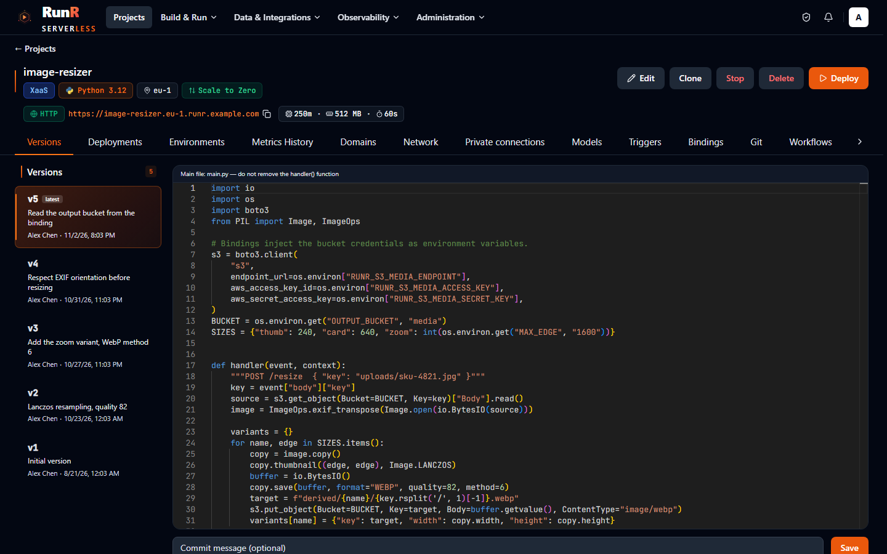
</p>
<p align="center"><sub>Konsolun editöründe tek dosyalık bir fonksiyon; kaydetmek bir sürüm oluşturur</sub></p>

<details>
<summary><b>Daha fazla ekran görüntüsü</b> - bir projenin genel görünümü</summary>

<p align="center">
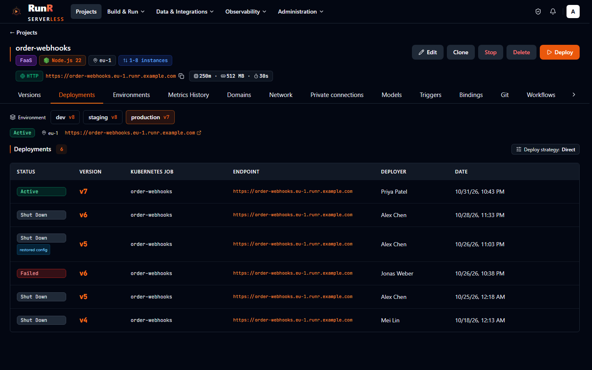
</p>
<p align="center"><sub>Bir projenin genel görünümü: URL, tetikleyiciler, dağıtılan sürüm, ölçek ve son dağıtımlar</sub></p>

</details>

<br>

# Dağıtım stratejileri ve ortamlar

**Her değişiklik bir sürümdür. Her rollout izleyebileceğiniz, terfi ettirebileceğiniz ve geri alabileceğiniz bir rollout'tur.**

- **Sürümler ve dağıtımlar**: her kod ya da yapılandırma değişikliği, proje başına bir git deposuyla
  desteklenen bir sürümdür; hazır herhangi bir sürümü dağıtın, rollout'u canlı izleyin, çalıştığı
  yapılandırmayla geri alın ([sürümleme](docs/versioning.md)).
- **Dağıtım stratejileri**: fonksiyon başına blue-green ve canary rollout'lar; test URL'leri, sağlık
  kontrollerinden sonra terfi, yeni revizyonun hata oranına ya da gecikmesine göre otomatik geri
  alma ve anında geri alma için sıcak tutulan önceki revizyon ([dağıtım stratejileri](docs/deploy-strategies.md)).
- **Ortamlar ve terfi**: tek bir projenin dev, staging ve production ortamları; kendi yapılandırma
  üst yazımları, sırları, binding'leri, alan adları ve bölgeleri, ortam başına bir git dalı ve aynı
  imajın onaylı terfisi ([ortamlar](docs/environments.md)).
- **Git push ve sağlayıcılar**: her projenin kendi git uzak deposu vardır (`git push runr main`) ya
  da proje GitHub (GitHub App), GitLab ya da Forgejo / Gitea üzerindeki bir depoya bağlanır: push
  ile dağıtım, commit durumları ve her pull / merge request için kendi URL'si, scale-to-zero'su ve
  otomatik temizliği olan bir **önizleme ortamı** ([git ile dağıtım](docs/git-deploy.md)).
- **Terminalden ya da CI'dan**: `runr` [CLI](docs/cli.md); projeler, değişkenler, alan adları,
  dağıtımlar, binding'ler, runtime'lar, workflow tetikleyicileri, model servisleri, barındırılan
  MCP sunucuları, erişim denetimi ve markalama için [Terraform provider](docs/terraform.md) ve push'ta
  dağıtan, pull request'ler için önizleme ortamları çalıştıran bir [GitHub Action](docs/github-action.md).
- **Yüklemeler ve ağ**: `docker save` arşivleri, OCI imaj tar'ları ve `.wasm` modülleri, bir bölgenin
  registry'sine devam ettirilebilir parçalarla yüklenir - internet erişimi olmayan bölgeler için de
  ([yüklenen imajlar](docs/images.md)); proje başına alt alan adları, yol tabanlı API gateway'leri,
  yüklenen sertifikalarla ya da RunR'ın her bölgede kurduğu cert-manager'ın sertifikalarıyla özel
  alan adları.

<p align="center">
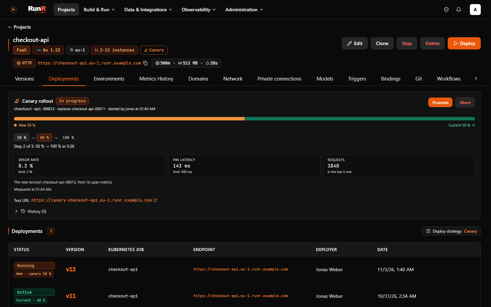
</p>
<p align="center"><sub>Canlı bir rollout: derleme, imaj, revizyon, trafik</sub></p>

<details>
<summary><b>Daha fazla ekran görüntüsü</b> - dağıtım stratejileri, ortamlar</summary>

<table>
<tr>
<td width="50%" valign="top">

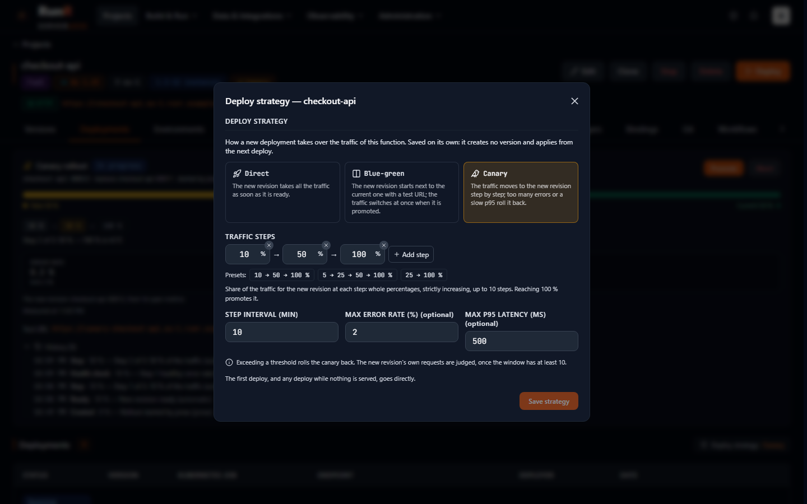

<sub>Dağıtım stratejisi: sağlık kontrolü ve sıcak önceki revizyonla blue-green ya da hata oranı ve gecikme eşikleriyle canary adımları</sub>

</td>
<td width="50%" valign="top">

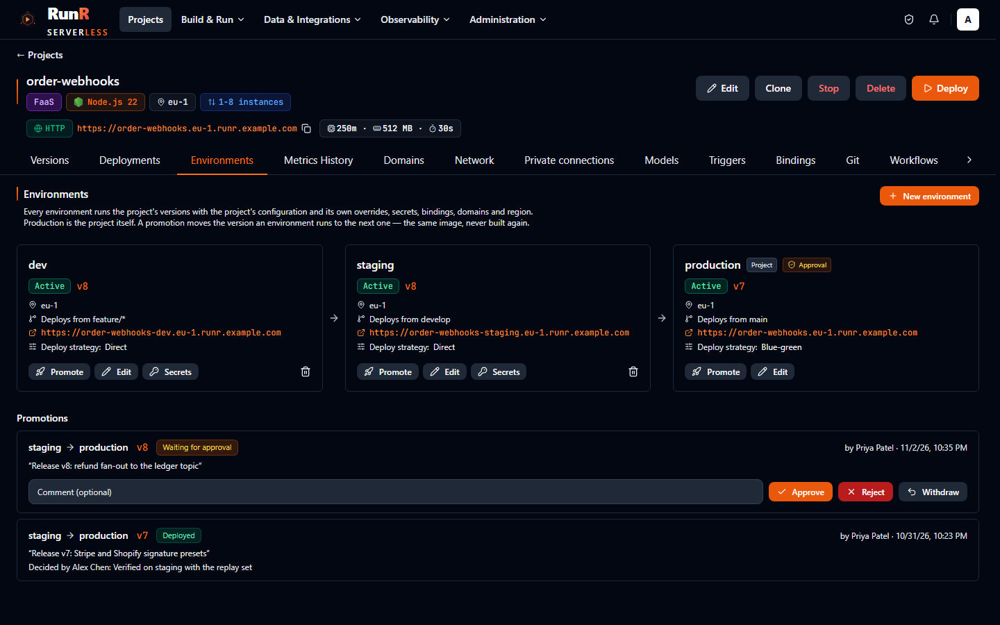

<sub>Ortamlar: dev, staging ve production, her birinin çalıştırdığı sürüm, onay bekleyen bir terfi</sub>

</td>
</tr>
</table>

</details>

<br>

# Tetikleyiciler, veri ve durable workflow'lar

**Olan her şey bir fonksiyonu çağırabilir ve bir fonksiyonun bitmesi günler alabilir.**

- **Tetikleyiciler**: proje başına bir liste - HTTP, bir saat diliminde zamanlamalar, kuyruklar
  (Redis Streams), imza ön ayarları ve yeniden oynatmalı bir webhook gelen kutusu, fan-out
  topic'ler, platform olayları ve broker ile dış kaynaklar (Kafka, NATS, RabbitMQ, MQTT, Postgres
  CDC, S3, IMAP üzerinden e-posta) - projenin olay gateway'i tarafından yeniden deneme ve dead letter
  ile teslim edilir ([tetikleyiciler](docs/triggers.md)).
- **Durable workflow'lar**: ilerlemesi çökmelere, yeniden dağıtımlara ve günler süren uykulara
  dayanan, kod öncelikli, adım tabanlı fonksiyonlar - yeniden denemeler, zamanlayıcılar, olaylar,
  alt workflow'lar - Python ve TypeScript SDK'ları ve konsolda bir çalışma geçmişiyle
  ([workflow'lar](docs/workflows.md)).
- **Binding'ler**: yönetilen KV (Redis), nesne depolama (Garage üzerinde S3 ya da dış bir uç nokta),
  Postgres (CloudNativePG) ve dış kimlik bilgileri; projelere bağlanır ve ortam değişkeni olarak
  enjekte edilir; rotasyon, saklama ve geri yükleme ile ([binding'ler](docs/bindings.md)).
- **İç ağ**: bir bölgenin projeleri birbirini adıyla çağırır, çağrılanın izin listesi karar verir;
  bir proje herkese açık, bir IP izin listesinden açık ya da yalnız içeriden erişilir
  ([iç ağ](docs/internal-network.md)).
- **API ürünü**: bir gateway'in API'sini tüketiciler, API anahtarları, JWT rotaları, hız sınırlı ve
  kotalı planlar ve kendi faturalama sisteminiz için ölçülen kullanımla başkalarına sunun
  ([API ürünü](docs/api-product.md)).

<p align="center">
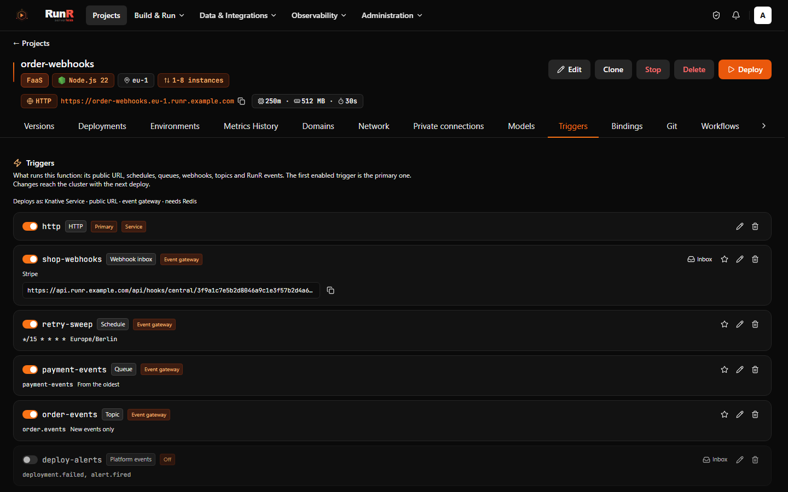
</p>
<p align="center"><sub>Bir projenin tetikleyicileri: HTTP, bir zamanlama, bir kuyruk ve bir webhook gelen kutusu tek listede</sub></p>

<details>
<summary><b>Daha fazla ekran görüntüsü</b> - bir workflow çalışması</summary>

<p align="center">
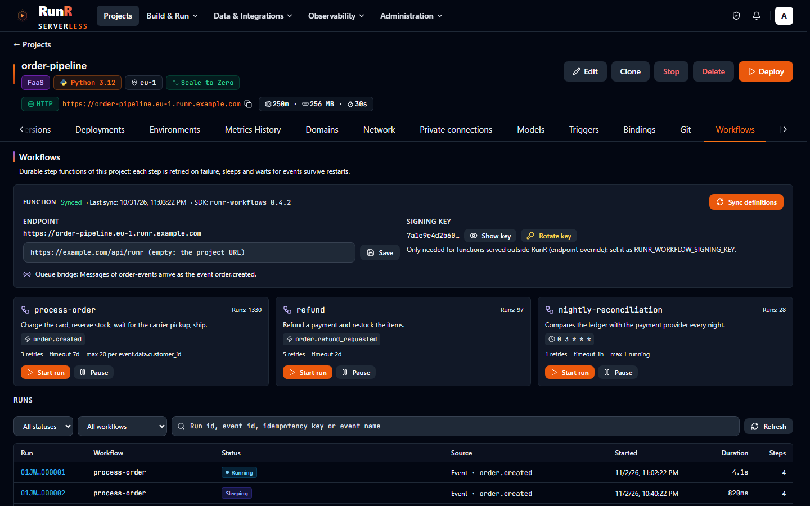
</p>
<p align="center"><sub>Bir durable workflow'un çalışmaları: her adım, yeniden denemeleri ve aralarındaki uykular</sub></p>

</details>

<br>

# AI ajanları için sandbox'lar

**Bir ajanın yazdığı kod, ajanın makinesinde değil, cluster'ınızdaki bir mikro-VM'de çalışır.**

- **Sandbox API** yalıtılmış, kısa ömürlü sandbox'lar oluşturur: exec, dosyalar, arka plan
  süreçleri, bir terminal ve bir kod yorumlayıcı, Python ve TypeScript SDK'larıyla
  ([Sandbox API](docs/sandbox-api.md)).
- Bir sandbox, bölgenin sunduğu en güçlü yalıtımda çalışır - bir **Kata Containers** mikro-VM'i ya da
  **gVisor** - siz izin vermedikçe ağ erişimi olmadan, kendi CPU, bellek, disk ve süreç
  sınırlarıyla ayrıcalıksız bir kullanıcı olarak ([güvenlik modeli](docs/sandbox-api.md#security-model)).
- **Sıcak havuzlar** hazır bir sandbox'ı saniyenin altında verir; organizasyon başına kotalar ve
  ölçüm kullanımı sınırlar içinde tutar ([sıcak havuz](docs/sandbox-api.md#warm-pool)).
- Ajanlar sandbox'lara SDK'lar, REST API ya da RunR MCP sunucusunun MCP araçlarıyla ulaşır
  ([MCP araçları](docs/sandbox-api.md#mcp-tools)).

<p align="center">
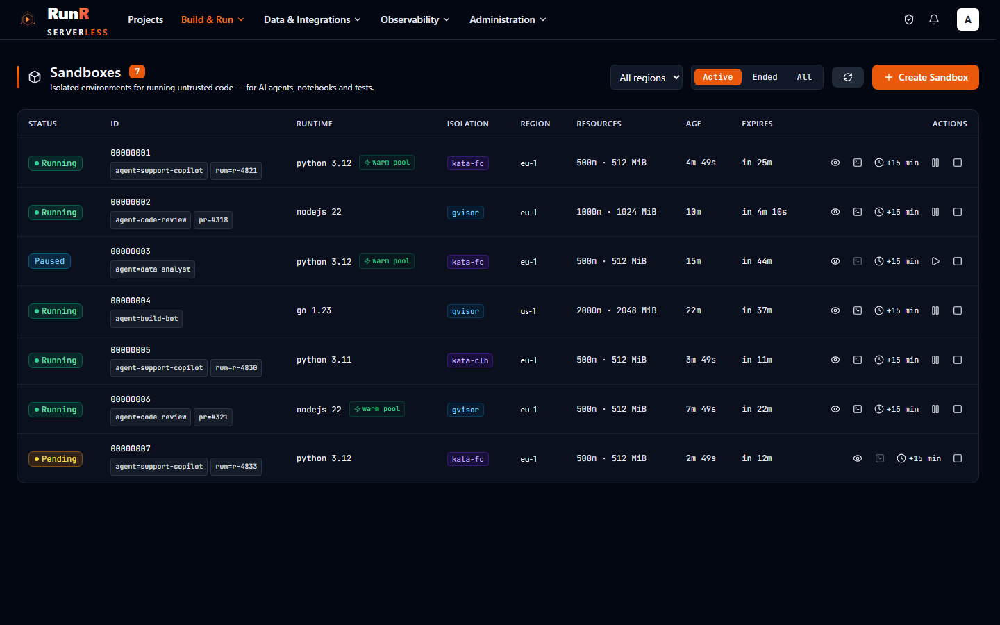
</p>
<p align="center"><sub>Bir sandbox: runtime sınıfı, sınırları, süreçleri ve çalıştırdığı komutlar</sub></p>

<br>

# GPU, Hugging Face modelleri ve MCP

**Modeller ve onları kullanan kod, serverless, kendi GPU'larınızda.**

- **GPU işçileri**: RunR NVIDIA GPU düğümlerini algılar, device plugin'i ya da GPU Operator'ı kurar
  ve GPU fonksiyonlarıyla container'larını oraya zamanlar; sıfıra ölçeklenir ve GPU süresiyle
  ölçülür; GPU CaaS, GPU sayısı, ürünü ve bellek gereksinimiyle herhangi bir imajı çalıştırır
  ([AI](docs/ai.md)).
- **Hugging Face modelleri**: tek tıkla model servisleri (vLLM, TGI, TEI, `hf-serve` ya da kendi
  imajınız) çevrimiçi ya da tamamen çevrimdışı, bir oyun alanı ve her dildeki fonksiyonlar için model
  binding'leri; internet erişimi olmayan bölgeler modellerini yükleme ya da içe aktarmayla alır
  ([Hugging Face](docs/huggingface.md)).
- **MCP sunucusu**: `/mcp` adresindeki yerleşik Model Context Protocol sunucusu, Claude Code gibi
  ajanların RunR'ı token'larının yetkileri içinde işletmesini sağlar; tek tıkla OAuth 2.1 ile
  ([MCP](docs/mcp.md)).
- **MCP barındırma**: kendi MCP sunucularınız - Python ve TypeScript başlangıç şablonları ya da
  herhangi bir imaj - herkese açık, token'lı ya da OAuth erişimli bir gateway'in arkasında proje
  olarak çalışır; çağrı günlüğü ve bir denetleyici ile ([MCP sunucusu barındırma](docs/mcp.md#hosting-mcp-servers)).

<p align="center">
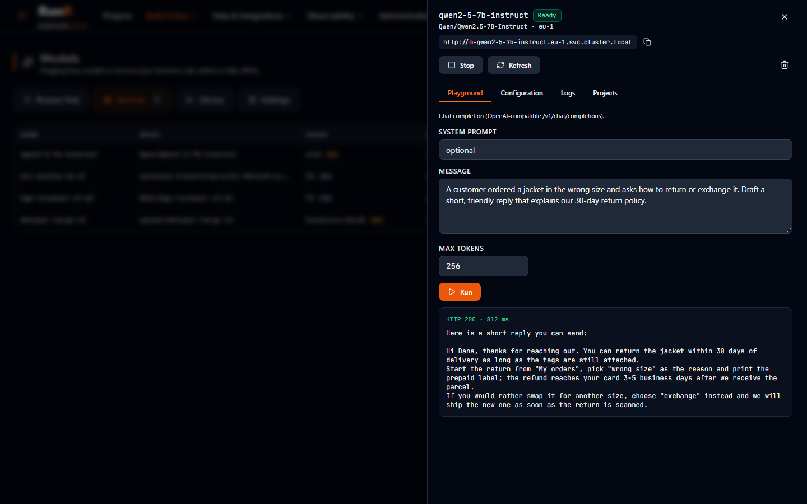
</p>
<p align="center"><sub>Hugging Face Hub'dan bir model, motoru, kipi ve GPU'suyla model servisi olarak dağıtılmış</sub></p>

<details>
<summary><b>Daha fazla ekran görüntüsü</b> - MCP sunucusu</summary>

<p align="center">
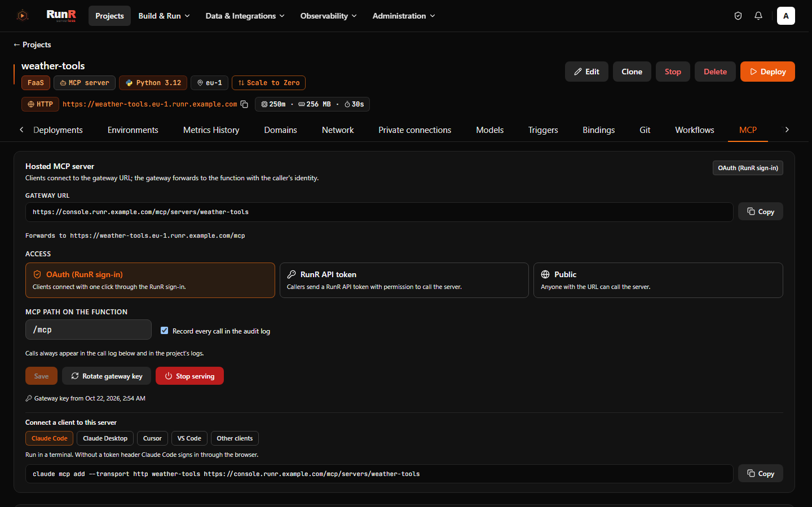
</p>
<p align="center"><sub>MCP: RunR'ın kendi sunucusuna bağlı istemciler ve proje olarak barındırılan MCP sunucuları</sub></p>

</details>

<br>

# Güvenlik ve kurumsal

**Tek bir yetki kataloğu, bölgede kalan sırlar ve bir şey çalışmadan önce bir imaj politikası.**

- **RBAC**: tek bir yetki kataloğu, yerleşik ve özel roller, gruplar, proje başına erişim ve
  kapsamlı API token'ları ([yetkiler](docs/permissions.md)).
- **SSO**: Google, GitHub, Microsoft, GitLab, OpenID Connect ve SAML 2.0; SSO gruplarının rollere
  eşlenmesiyle; isteğe bağlı iki aşamalı doğrulama ([modüller](docs/modules.md)).
- **Denetim günlüğü**: girişlerin, değişikliklerin, dağıtımların, kabuk oturumlarının ve reddedilen
  isteklerin yalnız eklenen kaydı; dışa aktarma ve SIEM'e iletme ile ([güvenlik](docs/security.md#audit-log)).
- **Depodaki sırlar**: saklanan her sır anahtar rotasyonuyla şifrelenir. Gizli ortam değişkenlerinin
  değerlerini RunR hiç saklamaz: doğrudan bölgenin Kubernetes Secret'larına ya da RunR'ın bölgede
  çalıştırdığı bir OpenBao'ya gider ya da kendi Vault / OpenBao, AWS, GCP ya da Azure sır deponuzda
  kalır ve bölgede bölgenin kimliğiyle okunur ([sır depoları](docs/secret-stores.md)); Postgres
  binding'leri kendilerine ait kısa ömürlü kullanıcılar alabilir ([dinamik kimlik bilgileri](docs/bindings.md#dynamic-credentials)).
- **Tedarik zinciri**: SBOM'lar, zafiyet taramaları (çevrimdışı da), cosign imzaları, dağıtımdan önce
  bir politika kapısı ve bölgede imzalı imaj kabulü; izin verilen bölgelere ve veri konumlarına
  sabitlenen organizasyonlar ([tedarik zinciri ve veri yerleşimi](docs/supply-chain.md)).

<p align="center">
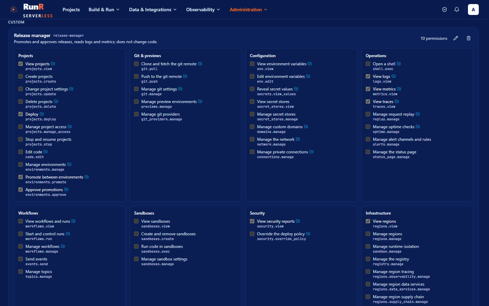
</p>
<p align="center"><sub>Roller: yerleşik roller, özel bir rol ve her birinin taşıdığı yetkiler</sub></p>

<details>
<summary><b>Daha fazla ekran görüntüsü</b> - bir imajın tedarik zinciri</summary>

<p align="center">
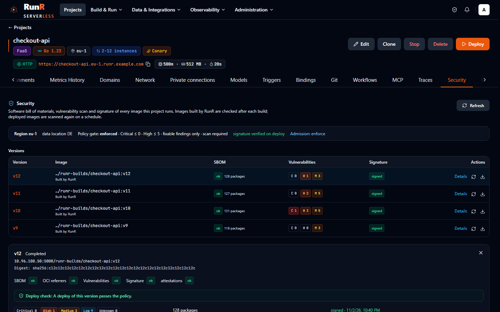
</p>
<p align="center"><sub>Tedarik zinciri: bir dağıtımın SBOM'u, tarama sonucu, imzası ve politika kapısı</sub></p>

</details>

<br>

# Bölgeler ve operasyon

**Herhangi bir Kubernetes cluster'ı bir bölge olur; tek bir proje birkaçında çalışabilir.**

- **Çok bölge**: herhangi bir Kubernetes cluster'ını bölge olarak kaydedin; RunR Knative Serving'i,
  Traefik'i, cluster içi bir Zot registry'sini, Redis'i, Prometheus'u, Loki'yi ve bölge ajanını
  kurar, `region:reconcile` ile güncel tutar ve bir bölgeyi yeni bir cluster'a taşır
  ([bölgeler](docs/regions.md)).
- **Global projeler**: tek bir proje, tek bir host adının arkasında birkaç bölgede; HA ya da yakınlık
  kipinde, sağlık kontrolleri, switchover ve failover ve bölgeler arası Postgres replikalarıyla
  ([global projeler](docs/global-projects.md)).
- **Gözlemlenebilirlik**: proje başına metrikler ve günlükler, Tempo ile OpenTelemetry izleme, istek
  yeniden oynatma, erişilebilirlik kontrolleri, herkese açık durum sayfaları ve uyarılar
  ([gözlemlenebilirlik](docs/observability.md)); bölgenin içinden k6 **yük testleri**
  ([yük testleri](docs/load-test.md)); bir projenin pod'larının gerçekten kullandığına göre
  **boyutlandırma** ([boyutlandırma](docs/monitoring.md#rightsizing)).
- **Canlı konsol**: WebSocket üzerinden gerçek zamanlı güncellemeler, çalışan pod'lara tarayıcıdan
  kabuk, rehberli turlar, İngilizce ve Türkçe ([tarayıcı kabuğu](docs/web-shell.md)).
- **Çok kiracılı sürüm**: kiracı başına bir PostgreSQL şeması, bölge başına kotalar, kiracılarla
  paylaşılan ve onların kâr payıyla yeniden sattığı platform bölgeleri ([kiracılık](docs/tenancy.md));
  her iki sürümde isteğe bağlı **faturalama**: bölge fiyatları, proje ve ay başına tek fatura ve
  kendi faturalama sisteminiz için bir faturalama API'si ([faturalama](docs/billing.md));
  **white-label** markalama, self servis kayıt ve karşılama ([white-label](docs/white-label.md));
  ekli destek biletleri.
- **Organizasyon dışa ve içe aktarma**: bir organizasyon sürümlü tek bir dosyaya paketlenir ve başka
  bir organizasyona ya da kuruluma aktarılır ([dışa ve içe aktarma](docs/org-export.md)).

<p align="center">
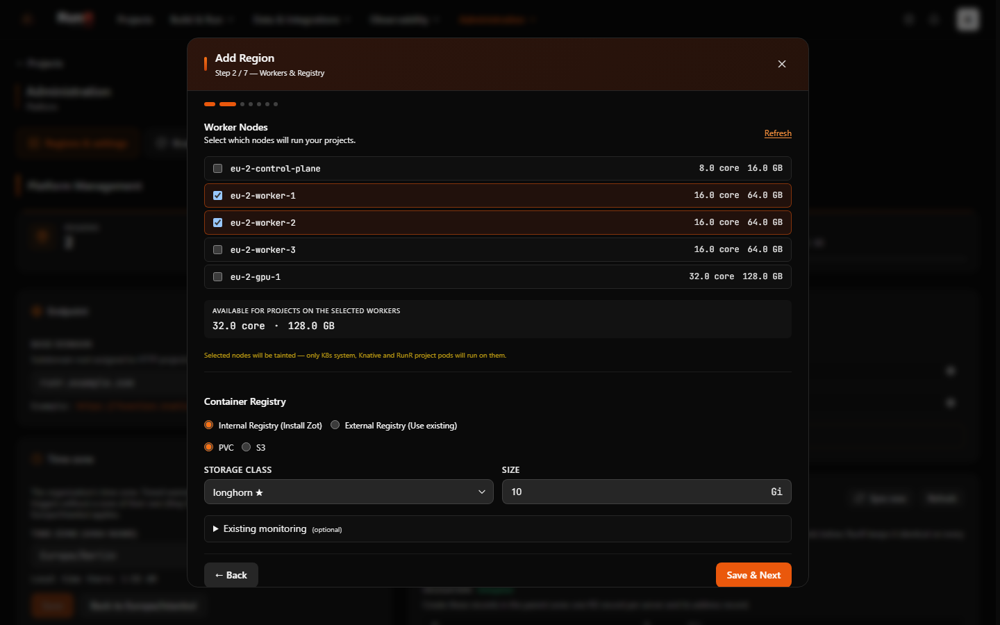
</p>
<p align="center"><sub>Bölge ekleme: bir kubeconfig yükleyin, RunR Knative Serving'i ve bölge bileşenlerini kurar</sub></p>

<details>
<summary><b>Daha fazla ekran görüntüsü</b> - günlükler ve metrikler, bir global proje</summary>

<table>
<tr>
<td width="50%" valign="top">

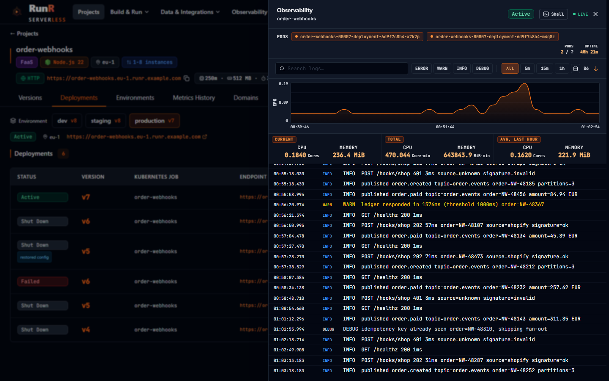

<sub>Bir projenin günlükleri ve metrikleri: istekler, gecikme, pod'lar, soğuk başlatmalar ve günlük akışı</sub>

</td>
<td width="50%" valign="top">

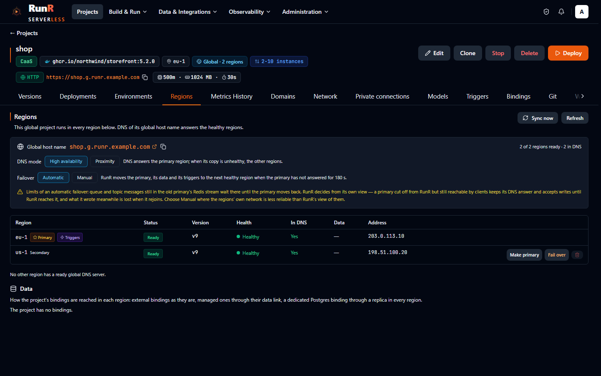

<sub>Bir global proje: bölgeleri, birincil bölge, her kopyanın sağlığı ve failover geçmişi</sub>

</td>
</tr>
</table>

</details>

<br>

# Ölçülen soğuk başlatma süreleri

RunR 0.5.0 ile 2026-10-15'te ölçüldü: test VM'inde tek düğümlü k3s v1.34.11 (8 vCPU Broadwell, iç
içe KVM, 15,6 GiB), Knative 1.21.3, gVisor 20260921.0, Kata Containers 3.28.0; fonksiyon 250m CPU /
256 MiB (container 500m / 512 MiB, WebAssembly 250m / 128 MiB), imaj düğümde, RunR'ın varsayılan
scale-to-zero ayarı; VM içinden Traefik üzerinden HTTPS, her istekte yeni bağlantı. Soğuk başlatma:
sıfır replikadan ilk tam HTTPS yanıtına, medyan (p90), her biri n=12. Sıcak istek: 100 isteğin
medyanı.

| Sandbox runtime'ı | Fonksiyon | Soğuk başlatma | Sıcak istek |
| --- | --- | --- | --- |
| runc | Python | 1,50 sn (2,14) | 9 ms |
| runc | Node.js | 1,62 sn (2,21) | 9 ms |
| runc | Go | 1,54 sn (1,87) | 9 ms |
| runc | PHP | 1,65 sn (2,48) | 9 ms |
| runc | Container imajı (CaaS) | 1,57 sn (2,02) | 9 ms |
| gVisor | Python | 1,97 sn (2,64) | 12 ms |
| Kata Containers + Cloud Hypervisor | Python | 3,11 sn (3,25) | 10 ms |
| Kata Containers + Firecracker | Python | 3,21 sn (3,47) | 10 ms |
| Kata Containers + QEMU | Python | 3,89 sn (4,45) | 10 ms |
| Kata Containers + Dragonball | Python | 3,95 sn (4,04) | 11 ms |
| WebAssembly (Spin shim) | Rust | 1,54 sn (1,84) | 9 ms |
| WebAssembly (Spin shim) | JavaScript | 2,12 sn (2,58) | 11 ms |

Kata yalnız Python ile ölçüldü; Firecracker'ın kök dosya sistemi containerd'nin devmapper
snapshotter'ındadır. Sandbox API, oluşturmadan ilk komuta (Python 3.14, 500m / 512 MiB, sınıf başına
n=10): gVisor altında soğuk 2,01 sn, Kata Firecracker altında 2,99 sn, Kata Cloud Hypervisor altında
4,01 sn; 2'lik sıcak havuzdan 0,28-0,36 sn. Kata soğuk başlatmasının nasıl düşürüldüğü ve kalan
sürenin nereye gittiği: [Kata hipervizörleri → Cold start](docs/kata-hypervisors.md#cold-start).

<br>

# Mimari

```
 Tarayıcı, CLI, MCP istemcileri ──► runr-gateway (Caddy)
               ├─ /                  → runr-ui      Vue 3 SPA
               ├─ /api               → runr-api     Octane (FrankenPHP) üzerinde Laravel 12
               ├─ /git               → runr-api     her projenin git smart HTTP uzak deposu
               ├─ /mcp, /oauth2      → runr-api     MCP sunucusu, barındırılan MCP sunucuları, OAuth 2.1
               └─ /ws                → runr-reverb  WebSocket: UI olayları, tarayıcı kabuğu, bölge ajanları
             runr-horizon (kuyruk işçileri) · runr-scheduler · PostgreSQL · Redis
                     │  Kubernetes API + Helm (kubeconfig)          ▲ WebSocket
                     ▼                                              │
 Bölge (herhangi bir Kubernetes cluster'ı)                           │
   Knative Serving + Traefik · proje Knative Service'leri / CronJob'lar / kuyruk tüketicileri
   Zot registry · Redis · gVisor / Kata Containers / Spin shim · GPU device plugin
   Prometheus · Loki · OpenTelemetry Collector + Tempo · veri servisleri · runr-agent ─┘
```

Kontrol düzlemi (API, UI, işçiler, WebSocket sunucusu, veritabanı) bir ya da daha fazla bölgeyi
yönetir. Derlemeler, dağıtımlar, tedarik zinciri çalışmaları ve bölge kurulumları kuyruktaki işler
olarak çalışır ve ilerlemeyi konsola gerçek zamanlı bildirir; her bölgedeki ajan metrikleri, pod
oturumlarını ve Kubernetes olaylarını geri akıtır. Bileşen bileşen tam resim:
[docs/architecture.md](docs/architecture.md).

<br>

# Depo düzeni

| Yol | İçerik |
| --- | --- |
| [`api/`](api) | Laravel 12 API (PHP 8.3); isteğe bağlı modüller `api/Modules` altında (AuthProvider, Tenancy, Ticket, Billing) |
| [`vue/`](vue) | Vue 3 + Vite konsolu (Pinia, Tailwind CSS, Monaco, xterm.js) |
| [`helm/`](helm) | Kontrol düzleminin `runr` Helm chart'ı |
| [`runtime/`](runtime) | Bölge ajanı, kuyruk tüketicisi, imaj yükleme alıcısı, tedarik zinciri araçları, Spin shim, `ci.sh` ve uçtan uca test düzeneği. Dil runtime imajları, evrensel sarmalayıcı ve hf-serve [BRF-Tech/runr-runtimes](https://github.com/BRF-Tech/runr-runtimes) deposundadır. |
| [`cli/`](cli) | `runr` CLI (Go) |
| [`terraform-provider-runr/`](terraform-provider-runr) | Terraform provider (Go) ve referans dokümanları; [BRF-Tech/terraform-provider-runr](https://github.com/BRF-Tech/terraform-provider-runr) deposundan yayımlanır |
| [`actions/`](actions) | GitHub Action `actions/deploy` |
| [`sdk/`](sdk) | Python ve TypeScript için workflow SDK'ları, `sdk/sandbox` altında Sandbox SDK'ları |
| [`examples/`](examples) | Runtime eklentisi, WebAssembly, AI, MCP sunucusu ve workflow örnekleri |
| [`proxy/`](proxy) | Geliştirme yığını için Sentry tüneli (Go) |
| [`compose/`](compose) | Tek sunucu Docker Compose kurulumu ve kind yardımcıları |
| [`scripts/`](scripts) | Geliştirme ortamı kurulumu (`devready.sh`) |
| [`ci/`](ci) | Sabitlenen Helm chart'ları ve Knative sürümleri için sürüm kontrolleri ve runr.sh'ın derlemesi |
| [`landing/`](landing) | [runr.sh](https://runr.sh) web sitesi ve bu sayfanın ekran görüntüleri (`landing/shots/`) |
| [`logo/`](logo) | RunR simgesi ve yazı markası (SVG) |
| [`docs/`](docs) | Dokümantasyon |

<br>

# Dokümantasyon

Dokümantasyon [runr.sh/docs](https://runr.sh/docs/) adresinde yayımlanır ve [`docs/`](docs) altında
durur; [dokümantasyon dizini](docs/README.md) her sayfayı konuya göre listeler. İyi ilk okumalar:
[mimari](docs/architecture.md), [üretim kurulumu](docs/install.md), [bölgeler](docs/regions.md),
[runtime'lar](docs/runtimes.md), [CLI](docs/cli.md) ve [roller ve yetkiler](docs/permissions.md).
Sürüm başına değişiklikler [CHANGELOG.md](CHANGELOG.md) dosyasında, her sürümün güncelleme notları
[docs/upgrade.md](docs/upgrade.md) sayfasındadır.

<br>

# Katkı

Issue'lar ve pull request'ler memnuniyetle karşılanır; büyük bir pull request'ten önce ne yapmak
üzere olduğunuzu anlatan bir issue açın. [CONTRIBUTING.md](CONTRIBUTING.md) geliştirme akışını, bir
değişikliğin geçmesi gereken kontrolleri (`ci.yml` her pull request'te çalıştırır) ve commit
kurallarını anlatır; proje [Contributor Covenant](CODE_OF_CONDUCT.md)'a uyar. Güvenlik sorunları
[SECURITY.md](SECURITY.md) dosyasının anlattığı gibi özel olarak bildirilir.

<br>

# Lisans

RunR [MIT Lisansı](LICENSE) ile yayımlanır.
Telif hakkı (c) 2026 BRF Teknoloji ve RunR katkıcıları.

Knative, OpenFaaS, AWS Lambda, Vercel, Hugging Face, Kubernetes ve bu sayfada geçen diğer proje ve
ürün adları başka taraflara aittir ve burada yalnız onları tarif etmek için kullanılmıştır. RunR
bunların hiçbiriyle bağlantılı değildir, hiçbiri tarafından desteklenmez ya da onaylanmaz.
