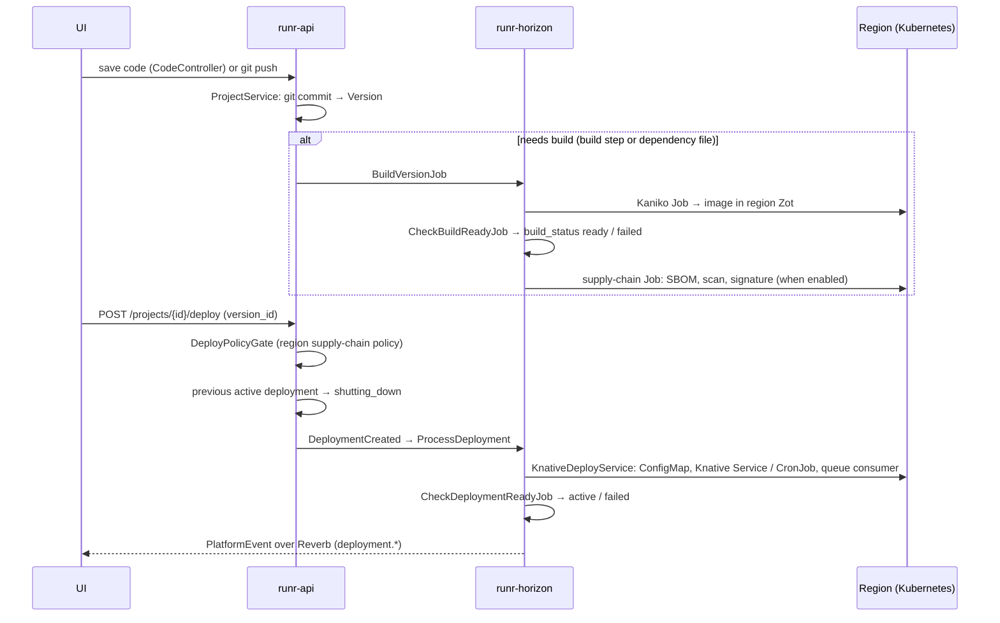

# Architecture

RunR is a serverless application platform on Kubernetes and Knative. A **control plane**
(API, UI, workers, WebSocket server, database) manages one or more **regions**. A region is a
Kubernetes cluster registered with its kubeconfig. RunR installs Knative Serving and its runtime
components on it and deploys users' projects there. Projects scale to zero when idle.

This page describes the components and how they interact. Related documents:

| Topic | Document |
|-------|----------|
| Documentation index | [README.md](README.md) |
| Local development setup, tests and CI | [development.md](development.md) |
| Runtimes, the universal wrapper | [runtimes.md](runtimes.md) |
| Roles and permissions | [permissions.md](permissions.md) |
| Secrets, encryption, audit log | [security.md](security.md) |
| Metrics, logs, tracing, uptime checks, alerts | [observability.md](observability.md) |
| Metric snapshots, sessions, usage metering | [monitoring.md](monitoring.md) |
| WebSocket topics (`PlatformEvent`) | [websocket-events.md](websocket-events.md) |
| Browser shell into pods | [web-shell.md](web-shell.md) |
| Version endpoint and image tags | [versioning.md](versioning.md) |
| Kata Containers hypervisors | [kata-hypervisors.md](kata-hypervisors.md) |
| Billing module: bills per project, prices, fixed resources, billing API, events | [billing.md](billing.md) |

## Topology

```
                         ┌──────────────────────────── Control plane ────────────────────────────┐
 Browser, CLI, ─ HTTPS ─►│  runr-gateway (Caddy)                                                 │
 MCP clients, git        │    /         → runr-ui      (Vue 3 SPA, served by Caddy)              │
                         │    /api/*    → runr-api     (Laravel 12, Octane on FrankenPHP)        │
                         │    /mcp, /mcp/*, /oauth2/*, /.well-known/oauth-* → runr-api (MCP)     │
                         │    /git/*    → runr-api     (git smart HTTP remotes)                  │
                         │    /oauth/*/callback → runr-api (SSO sign-in callback of a provider)  │
                         │    /horizon/*→ runr-api     (Horizon dashboard)                       │
                         │    /storage/*→ runr-api     (public disk)                             │
                         │    /ws/*     → runr-reverb  (Laravel Reverb, /ws prefix stripped)     │
                         │                                                                       │
                         │  runr-horizon (queue workers)   runr-scheduler (schedule:work)        │
                         │  PostgreSQL 17                  Redis 7 (queue, cache, sessions)      │
                         └────────────┬──────────────────────────────────────▲───────────────────┘
                                      │ Kubernetes API + Helm (kubeconfig)   │ WebSocket /ws/agent/{region}
                                      ▼                                      │
        ┌──────────────────────────── Region (Kubernetes cluster) ───────────┴─────────────────┐
        │ knative-operator   Knative Operator (Helm)                                           │
        │ knative-serving    Knative Serving (KnativeServing CR) + Traefik (Knative provider)  │
        │ <project ns>       project Knative Services, CronJobs, queue consumers, build Jobs,  │
        │                    model services, image upload receivers, the model volume, the     │
        │                    managed Redis runr-redis (Redis Streams for the queue trigger)    │
        │ runr-registry      Zot registry (builds, runtime images, uploads; pull-through)      │
        │ runr-sandbox       gVisor / Kata Containers / Wasm installers, RuntimeClasses        │
        │ observability      Prometheus, Loki, OpenTelemetry Collector, Tempo, runr-agent      │
        │ runr-data          binding data services: Redis (KV), Garage (S3), CloudNativePG     │
        │ runr-supply-chain  SBOM / scan / signing Jobs (cosign-system: policy-controller)     │
        │ runr-gpu           NVIDIA device plugin + GPU Feature Discovery, or GPU Operator     │
        │ runr-sbx-<org>     Sandbox API sandboxes, one namespace per organization             │
        └──────────────────────────────────────────────────────────────────────────────────────┘
```

The control plane can run in one of its regions or anywhere else that reaches the regions'
Kubernetes APIs. The runr-agent of each region connects back to the control plane over WebSocket.
The Knative Operator, Knative Serving with Traefik, the registry, the observability stack and the
agent are installed in every region; the other namespaces appear once the feature is installed or
used there.

## Control plane

| Component | Image / process | Role |
|-----------|-----------------|------|
| `runr-gateway` | `ghcr.io/brf-tech/runr/reqs/caddy` with the chart's Caddyfile (`helm/templates/gateway-configmap.yaml`) | Single entry point; routes `/` to the UI, `/api`, `/oauth/<provider>/callback` (SSO sign-in callbacks; the console's own `/oauth/callback` page stays with the UI), `/horizon` (the [Horizon dashboard](install.md#horizon-dashboard)), `/storage`, `/git` (when `gitDeploy.enabled`, streamed) and `/mcp`, `/oauth2`, `/.well-known/oauth-*` (streamed, [mcp.md](mcp.md)) to the API, `/ws` to Reverb; `/healthz` answers itself. The Compose gateway (`compose/Caddyfile`) routes the same paths to the API and Reverb and serves the console's files itself ([compose/README.md](../compose/README.md#service-architecture)) |
| `runr-ui` | `ghcr.io/brf-tech/runr/ui` (`vue/Dockerfile`, Caddy) | Vue 3 + Vite SPA (the console): Pinia, vue-i18n (EN/TR), Tailwind CSS, Monaco editor, xterm.js, driver.js tours |
| `runr-api` | `ghcr.io/brf-tech/runr/api`, `CONTAINER_ROLE=api` | REST API (`api/routes/*.php`), Sanctum token auth, OpenAPI docs via Scramble; also the MCP server and OAuth authorization server, the hosted MCP server gateway, the git remotes (`git http-backend`), the durable workflows engine API and the Sandbox API |
| `runr-horizon` | same image, `CONTAINER_ROLE=horizon` | Queue workers: deploys, builds, region installs, supply-chain runs, workflow steps, binding operations, image uploads, demo data |
| `runr-scheduler` | same image, `CONTAINER_ROLE=scheduler` | Periodic tasks (`api/routes/console.php` and the feature service providers) |
| `runr-reverb` | same image, `CONTAINER_ROLE=reverb` | WebSocket server: broadcasting, shell and sandbox PTYs, Sandbox API exec streams, runr-agent connections |
| PostgreSQL | `ghcr.io/brf-tech/runr/reqs/postgres:17-alpine` or external | Application data; one schema per tenant in multi-tenant mode |
| Redis | `ghcr.io/brf-tech/runr/reqs/redis:7-alpine` or external | Queues, cache, sessions, shell and exec tokens, live metrics |
| Mailpit | `ghcr.io/brf-tech/runr/reqs/mailpit` | SMTP catch-all, installed only when no SMTP host is set |

Placement (Helm values `placement.*`): every pod of the chart — the Deployments above and the
migration and bootstrap hook Jobs — tolerates the dedicated-worker taint
`runr.dev/dedicated=projects:NoSchedule` and prefers the nodes that are not dedicated workers
(`placement.tolerateDedicatedWorkers`, on by default). When RunR runs in a cluster it also uses as
a region, a node holding PostgreSQL's volume or the API storage can be selected as a dedicated
worker ([Dedicated workers](#dedicated-workers)); the pods still start there after a restart or an
upgrade. `placement.tolerations`, `placement.affinity` and `placement.nodeSelector` apply to every
pod as given; the dedicated-worker toleration and preference and the colocation of the pods that
share the API storage (`podColocation`) are added to them.

Hook Jobs of the chart (same API image): `runr-migrate-install-<revision>` (post-install) and
`runr-migrate-upgrade-<revision>` (pre-upgrade, before any Deployment changes) run the database
migrations, with the Tenancy module also `tenancy:migrate`. `runr-bootstrap` (post-install and
post-upgrade, `bootstrap.enabled`) runs `agent:redeploy --missing`, `images:move-registry`,
`region:reconcile` and `rbac:assign-missing`, in the multi-tenant edition
`tenancy:setup --force` (`bootstrap.tenancySetup`), and creates the first administrator while
the installation has none ([upgrade.md](upgrade.md#procedure)).

The roles are selected in `api/docker/entrypoint.sh`. The API role runs
`php artisan octane:start --server=frankenphp`. Reverb runs `php artisan reverb:start-shell`, a
Reverb server extended by `App\Services\Shell\ShellAwareFactory` with three raw WebSocket routes:
`/shell` (`ShellController`, deployment shells and sandbox terminals), `/sandbox-exec`
(`SandboxExecSocket`, [Sandbox API](sandbox-api.md#exec)) and `/agent/{regionId}`
(`AgentController`).

Scheduled tasks include `executor:sync` (runtime versions, every 30 minutes),
`knative:check-status`, `build:check-stale` and resource threshold checks (every minute),
`SnapshotMetricsJob` (every minute) and `DownsampleMetricsJob` (hourly) in the central schema and
in every tenant schema, `LogRetentionJob` (daily),
`metric-snapshot-retention` (daily: metric snapshots older than 90 days are removed, the daily
ones kept, in the central schema and in every tenant schema),
`registry-empty-repositories` (daily: build repositories without a tag in the regions' internal
registries go to Zot's garbage collection),
`close-stale-sessions` (every ten minutes: deployment sessions open for more than 30 minutes
without a reported end are closed, in the central schema and in every tenant schema; when the pod
was still running, its real end later corrects the session), the GPU inventory (`gpu:refresh`,
every two minutes) and the model service meter. The feature
service providers add their own: `workflows:tick` (every minute), the Sandbox API reaper, warm
pools and meter, uptime checks, alerts and tracing status (`observability:run`), supply-chain
re-scans, binding maintenance, preview cleanup and expired image uploads.

## Regions

Requirements, connecting a cluster, every region setting, status, migration and removal: [regions.md](regions.md).

A region (`App\Models\KnativeRegion`) is one Kubernetes cluster. Its kubeconfig is stored in the
database and never serialized in API responses. The region also holds its settings: function
domain, resource limits and timeouts, sandbox mapping, trusted ingress IPs and agent WebSocket
URL. All cluster operations go through
`App\Services\KubernetesClient` and `App\Services\HelmService` with that kubeconfig.

Setting up a region (each step is a queued job that reports progress over WebSocket):

1. **Kubeconfig**: upload, validate and preview the nodes. Worker nodes can be dedicated with
   taints and labels (`KnativeNodeTaintTrait`, [Dedicated workers](#dedicated-workers)).
2. **Registry + region**: `InstallRegistryAndCreateRegionJob` tests the storage and installs Zot
   (`ZotRegistryService`). Storage is a PVC or S3; an external registry can be used instead.
   With dedicated workers selected Zot runs on them; without, on any node, tolerating the
   dedicated-worker taint.
3. **Knative Operator**: Helm chart `knative-operator/knative-operator`. Offered Knative
   versions depend on the cluster's Kubernetes minor (`KnativeVersionHelper::KNATIVE_K8S_COMPAT`).
4. **Knative Serving** (`KnativeInstallService::installServing`): the KnativeServing resource, Traefik
   as Knative ingress (`KnativeTraefikTrait`, chart `traefik/traefik` pinned in
   `KnativeConstants`, its image from the `ghcr.io/brf-tech/runr/reqs` mirror; Helm value
   `knative.traefikImage` / `KNATIVE_TRAEFIK_IMAGE` names another), the project namespace with an optional ResourceQuota/LimitRange,
   Prometheus and Loki (installed, or existing ones reused), the tracing backend
   (`observability.tracing.installWithServing`) and the runr-agent.
5. **Redis** (optional, needed for the queue trigger): `InstallRedisJob` — RunR's managed Redis
   (Deployment and Service `runr-redis` in the project namespace), or the address of one already
   running in the cluster or outside it.
6. **Sandbox** (optional): gVisor and/or Kata Containers (see [Sandbox runtimes](#sandbox-runtimes)),
   and WebAssembly support.

Optional per-region features, each installed from the region's settings in the console:

| Feature | What RunR installs | Document |
|---------|--------------------|----------|
| WebAssembly | `wasm-installer` DaemonSet (`runr-sandbox`) with the Spin shim (`containerd-shim-spin`, optional Wasmtime shim), RuntimeClass `wasmtime-spin-v2`, Knative features for RuntimeClass and node selector | [wasm.md](wasm.md) |
| Tracing | OpenTelemetry Collector + Grafana Tempo in `observability`; mode `managed`, `reuse`, `external` or `off` | [observability.md](observability.md#tracing-backend) |
| GPU support | NVIDIA device plugin + GPU Feature Discovery, or the NVIDIA GPU Operator (`runr-gpu`) | [ai.md](ai.md) |
| Data services | KV Redis, Garage object storage, CloudNativePG and a shared PostgreSQL cluster (`runr-data`, `cnpg-system`) | [bindings.md](bindings.md#region-setup) |
| Supply chain | SBOM / scan / signing Jobs (`runr-supply-chain`), optional sigstore policy-controller admission (`cosign-system`) | [supply-chain.md](supply-chain.md) |
| Sandbox API | Namespaces `runr-sbx-<organization>` with Pod Security `restricted` and a default-deny NetworkPolicy, created on first use | [sandbox-api.md](sandbox-api.md) |

`region:reconcile` brings existing regions up to date with the running release. Its steps are in
`App\Services\RegionReconcile\Steps`, in this order: dedicated-worker toleration
([Dedicated workers](#dedicated-workers); first, as the steps after it restart the registry, Loki
and Tempo), Knative Serving config, Prometheus exposure,
namespace quota, registry sync, ingress trust, Traefik image, request timeout (the region
Traefik's read / write timeouts and Knative's maximum revision timeout follow the regions'
`request_timeout`), Loki deletion, tracing backend (where tracing is enabled), Kata sandbox, WebAssembly
sandbox, admission policy, image registry (workloads onto RunR's image namespace
`ghcr.io/brf-tech/runr`, [upgrade.md](upgrade.md#image-namespace-ghcriobrf-techrunr)) and
registry pre-warm (the base images of function builds). The pre-warm comes last because registry
sync and image registry restart the registry; its Job waits for the registry to answer, and a
pre-warm Job that failed is started again by the next run. The steps act on active regions — the
platform's and, with the Tenancy module, every tenant's own; then the status block of every
region with Knative Serving ready, platform regions and tenants' own regions alike, is brought to
its status — applied for an inactive or maintenance region, removed from an active one
([regions.md](regions.md#region-status)).

**Region migration** (`RegionMigrateService`, `POST /api/knative-regions/{id}/migrate`) moves a
region to a new cluster. It installs there what the region had on the old one (Knative, Redis,
the registry, the dedicated workers that exist there, the sandbox runtimes, WebAssembly and GPU
support, the data services, the admission policy, function TLS, the Skupper site and the status
block), redeploys every project's latest version and waits for the region's DNS to point at the
new ingress. The status goes through `pending → in_progress → dns_check → completed`; a
migration in `dns_check` or `failed` can be rolled back to the previous kubeconfig
([regions.md](regions.md#moving-a-region-to-another-cluster)).

**Base-domain migration** (`DomainMigrateService`): a changed platform base domain moves the
regions whose function domain is `<region>.<base domain>`. The region keeps its function domain
and also answers on the new one through `runr-domain-alias` in its project namespace
(`RegionDomainAliasService`: a small proxy that rewrites `<service>.<new domain>` to the Knative
Service's cluster-local host on the region Traefik) until DNS of the new domain answers its
external address — the status check every minute and the scheduler hourly check it
(`RegionDnsCheck`) — or the migration is completed by hand; then Knative's config-domain, the
KnativeServing resource and the region's `knative_domain` move to the new domain
([regions.md](regions.md#changing-the-base-domain)).

**Organization domain moves** (`TenantDomainService`, Tenancy module): a tenant's changed domain
moves the same way. On the platform regions assigned to the tenant, an alias of the tenant's own
(`runr-domain-alias-t<hash of the tenant id>`, serving only the tenant's Knative Services)
answers on `<region>.<new domain>` next to the config-domain entry of the current domain; once
DNS answers, the new entry is added, the old one and the alias removed. The tenant's own regions
move through `DomainMigrateService` in the tenant's context. A scheduled check every five minutes
completes both region by region; **Complete now** in the console (`PATCH /api/settings`
`{"complete_domain_migration": true}`) completes the move by hand
([tenancy.md](tenancy.md#organization-domain)).

### Dedicated workers

Selecting worker nodes (region setup, or Administration → Platform → Knative Regions → (region) → Workers;
`KnativeNodeService::applyWorkerSelection()`) labels and taints them
`runr.dev/dedicated=projects:NoSchedule`; deselected nodes lose both. Project workloads (Knative
Services, queue consumers, CronJobs, model services, sandboxes) carry the matching nodeSelector and
toleration and run on the dedicated workers only; Knative's system deployments move there too.

RunR's components with a node-bound volume tolerate the taint and prefer the nodes that are not
dedicated workers (`DedicatedWorkers::systemPlacement()`: the toleration and a preferred node
affinity):

| Component | Namespace | Volume |
|---|---|---|
| Registry (Zot, `runr-zot`) | the region's registry namespace (`runr-registry`) | PVC of its StatefulSet (storage `pvc`; with S3 Zot has none) |
| Prometheus (`knative` release) | `observability` | 50Gi PVC |
| Loki (`loki-stack`) | `observability` | 20Gi PVC |
| Tempo (`tempo`, tracing mode `managed`) | `observability` | `tempoStorage` PVC |
| KV Redis, Garage, CloudNativePG clusters | `runr-data` | the data services' PVCs |

RunR's own pods (the Helm chart, PostgreSQL and the API storage included) tolerate the taint and
prefer the other nodes as well, for a RunR that runs in a cluster it also uses as a region
([Control plane](#control-plane), `placement.tolerateDedicatedWorkers`).

A node-bound volume (local-path, k3s's default class, any volume with node affinity) keeps its pod
on the node it was provisioned on, and that node can be selected as a dedicated worker later. The
taint leaves the running pod alone; the next pod (a restart, a new pod template, a Helm upgrade, a
moved image) has to start on the same node again, which the toleration allows. A registry
installed while dedicated workers are selected runs on them (nodeSelector and toleration).

A component installed by an earlier release gets the toleration added to its pod template (the
Prometheus and CloudNativePG resources: their spec) when it needs it
(`DedicatedWorkerTolerationService`): a pod of it runs on a dedicated worker, or waits Pending on
the taint ("untolerated taint {runr.dev/dedicated: projects}" together with "volume node affinity
conflict"). The worker selection does this for the nodes it selects; `region:reconcile` (step
`dedicated-worker-toleration`) for every dedicated worker of the cluster:

- a pod on a dedicated worker restarts once, on the same node;
- a pod Pending on the taint, created from the spec without the toleration, is deleted once its
  controller has the new spec, and the controller starts it again with the toleration — a
  StatefulSet does not replace a pod that never became ready by itself, and the CloudNativePG
  operator recreates the instance on its volume. The KV Redis Deployment replaces its pod itself.

Components on the other nodes keep their pod template until their node is selected. The registry
restart of `registry-sync-config` adds the toleration too, so a registry restarted there needs no
second restart later.

A registry installed while dedicated workers are selected, its node mirror and Knative's system
deployments select the workers with a nodeSelector on the label. When deselected nodes lose it,
the worker selection and the same `region:reconcile` step keep them schedulable:

| Component | While some node carries the label | Once none does |
|---|---|---|
| Zot (StatefulSet on a volume) | stays on the workers; if its volume binds it to a node that lost the label (its pod there, or Pending on the nodeSelector), it moves to the placement above: nodeSelector dropped, toleration kept, the other nodes preferred, a Pending pod replaced | moves to that placement; its pod restarts once, on its volume's node |
| Zot (Deployment, S3) | follows the remaining workers | moves to that placement |
| Node mirror (`runr-registry-mirror`) | follows the remaining workers | applied for every node, as an install without dedicated workers has it |
| Knative system deployments | follow the remaining workers | nodeSelector dropped, toleration kept |

Without dedicated workers projects run on any schedulable node, and a node pulls images from the
registry (an http address) only with the containerd configuration the mirror writes, so the
mirror moves to every node. On plain containerd a node whose `config.toml` the mirror changes
needs the containerd restart its log names (`php artisan registry:rolling-restart <region-id>`);
k3s and rke2 read the mirror's `hosts.toml` without a restart.

### Region capacity and admission

The **region capacity** (`total_cpu_m` / `total_memory_mb`) is what the nodes RunR workloads run
on leave for them: per node the allocatable minus the requests of the platform pods on it
(Kubernetes, Knative, the ingress, the registry, observability, DaemonSets and anything else the
cluster runs). With dedicated workers only those nodes count. Pods of projects (label
`runr/project-id`, build Jobs included), model services (`runr.sh/model-service`) and the Sandbox
API (`runr.dev/sandbox=true`, warm pool pods included) are not platform pods: admission counts them
from their own records, once. The region status check refreshes the capacity
(`KnativeNodeService`).

Admission (`App\Services\Helpers\RegionCapacity`) splits every workload's reservation between two
budgets per resource:

| Budget | Size | What counts against it |
|---|---|---|
| **Always-on** | the region capacity, no overcommit | always-on projects (`min_scale` ≥ 1, or `scale_to_zero: false`): (size + queue-proxy + Kata pod overhead) × `max(1, min_scale)`; the Kata pod overhead of one pod of every scale-to-zero project that runs on Kata; queue consumers; model services by the same rules; live sandboxes and warm pool pods (size + Kata pod overhead) |
| **FaaS overcommit** | capacity × the region's overcommit factor, minus what the always-on budget holds | one pod of every scale-to-zero project and model service: size + queue-proxy (a `schedule` project: its size, the CronJob has no queue-proxy) |

The queue-proxy counts with its requests (100m CPU, 100 MiB); a schedule project counts as
scale-to-zero whatever its `min_scale`, as its CronJob runs only while a run lasts. A workload is
admitted when its always-on part fits what the always-on budget has free and its whole reservation
fits what the FaaS budget has free. Admission runs on project create, on update (size,
`min_scale`, `scale_to_zero`, trigger or region), on deploy, for model services on create, start
and change, and for every new sandbox and warm pool pod. A project or model service whose
reservation does not grow always passes, even on a region that is over capacity. A sandbox
served from a warm pod passes too: the warm pod holds its capacity already.

A refusal (422) names the budget and what is still free:

```text
CPU limit exceeded on the FaaS overcommit budget: this needs 350m, 200m of 3000m are free (region capacity 1000m × 3, minus 0m always-on).
CPU limit exceeded on the always-on budget (no overcommit): this needs 400m, 200m of the region capacity 1000m are free. Always-on workloads, Kata pod overhead, queue consumers, sandboxes and model services reserve real capacity.
```

The Sandbox API refuses with reason `quota_capacity` ([Errors](sandbox-api.md#errors)).

**Kata pod overhead.** A pod under a Kata RuntimeClass carries that class's `overhead.podFixed`
(250m CPU, 256–320 MiB, [kata-hypervisors.md](kata-hypervisors.md)). A project counts the overhead
of the RuntimeClass it was last deployed with: the deploy records it
(`projects.deployed_runtime_class`, `runc` when the pods have none). A changed sandbox mapping
therefore counts from each project's next deploy, which is checked against the new mapping. A
project that was never deployed, or was moved to another region, counts with its region's current
mapping until its next deploy. Model services record theirs the same way
(`ai_model_services.runtime_class`, the region's CaaS mapping until their first deploy); sandboxes
count their sandbox class.

**Overcommit factors.** Each region has one factor per resource:

| Setting | Default | Range |
|---|---|---|
| `faas_cpu_overcommit` | 3 | 1–10, two decimals |
| `faas_memory_overcommit` | 1.5 | 1–10, two decimals |

Overcommit admits more scale-to-zero workloads than the region can run at the same time; it does
not overcommit a node. The scheduler places pods by their requests, so when more of them wake up
at once than the region holds, the extra pods wait as Pending until others scale to zero, and
Knative's activator holds their requests up to the request timeout. The defaults reflect how
the two resources behave when that happens:

- **CPU, 3:** CPU is shared by weight. Pods on a busy node slow down instead of failing, and the
  queue-proxy's CPU limit above its request (1 CPU) only uses CPU the node has idle. A
  scale-to-zero function holds its CPU request only while it serves requests.
- **Memory, 1.5:** memory cannot be shared or reclaimed from a running pod. A pod holds its memory
  request from start to scale-down, including Knative's idle window after its last request, and a
  node that runs short of memory evicts or OOM-kills pods instead of slowing them down. Memory
  the requests do not show (page cache, kernel, a Kata VMM above its overhead) adds to that
  pressure. With the lower factor, the worst case (every admitted workload awake at once) asks
  for at most half the region capacity more than fits.

A factor of 1 turns overcommit off: every reservation then counts against the region capacity.
New regions start with the defaults; the upgrade migration gives existing regions the defaults too.

Administration → Platform → Knative Regions → (region) → Workers shows both budgets and sets the factors. In the API:

```bash
curl -sS "$API/knative-regions/$REGION/capacity" -H "Authorization: Bearer $TOKEN"
curl -sS -X PUT "$API/knative-regions/$REGION/capacity" -H "Authorization: Bearer $TOKEN" \
  -H 'Content-Type: application/json' -d '{"faas_cpu_overcommit": 4, "faas_memory_overcommit": 1.5}'
```

```json
{"data": {"region_id": "01J…", "faas_cpu_overcommit": 3, "faas_memory_overcommit": 1.5,
  "cpu_m": {"capacity": 4505, "always_on_used": 1200, "always_on_available": 3305,
            "faas_overcommit": 3, "faas_budget": 12315, "faas_used": 3150, "faas_available": 9165,
            "utilization": 32.2},
  "memory_mb": {"capacity": 12000, "…": "…"}}}
```

`faas_budget` is capacity × factor minus `always_on_used`; `utilization` is the fuller budget in
percent. Reading needs `regions.view`, changing `regions.manage` (both in
`api/config/route_permissions.php`; with the Tenancy module a platform region is changed by the
platform administrators, an organization's own region by its owner or admins, and an organization
reading a platform region gets 403, its quota applies). The region resource
(`GET /api/knative-regions/{id}`) carries the factors and the same `capacity` object; its
`used_cpu_m` / `used_memory_mb` add up every admitted reservation (projects, model services,
sandboxes) and can exceed `total_cpu_m` / `total_memory_mb` on an overcommitted region. Capacity
alerts (`resource_threshold`, 60 % / 80 %) measure the fuller of the two budgets.

**Organization quotas.** With the Tenancy module each organization has a CPU and memory quota per
platform region (`cpu_quota_m` / `memory_quota_mb`, 0 = no limit for that resource), its share of
the region capacity: the quotas on a region add up to at most its capacity (and the
[organization ceiling](#editions)). Admission (`TenantQuotaService`, `CheckTenantQuota`) splits a
quota into the same two budgets, with the region's overcommit factors:

| Budget | Size | What counts against it |
|---|---|---|
| **Always-on** | the quota | the organization's always-on projects and model services, the Kata pod overhead of its scale-to-zero ones, queue consumers, its sandboxes and warm pool pods |
| **FaaS overcommit** | quota × the region's factor, minus what the always-on budget holds | one pod of every scale-to-zero project, model service and [git deploy preview](git-deploy.md#preview-environments) of the organization |

A workload has to fit both the region's budgets and its organization's. Because the quotas share
out the capacity and use the region's factors, the organizations' quotas × factor add up to at
most the region's capacity × factor. A factor of 1 on a region makes the quotas there hard limits
for every workload. The refusal (422) names the budget (`budget`: `always_on` or `faas`) and the
resource that is short, and gives what is left for each resource with a quota (`remaining_cpu_m`,
`remaining_memory_mb`; a resource with quota 0 is not limited and has no entry):

```text
CPU quota exceeded on the organization's FaaS overcommit budget: this needs 350m, 200m of 3000m are free on this region (quota 1000m × 3, minus 0m always-on).
CPU quota exceeded on the organization's always-on budget (no overcommit): this needs 700m, 650m of the quota 1000m on this region are free. Always-on workloads, Kata pod overhead, queue consumers and sandboxes count in full.
```

In an organization, `GET /api/settings` gives each platform region with a quota the quota's
budgets as its `capacity` (the shape above, `capacity_scope: "quota"`). The projects page shows
both budgets per resource, of the regions or of the organization's quotas, summed and per region.
Platform administrators see each organization's quota budgets in Tenants → (tenant) → Regions
(`GET /api/tenants/{id}/regions`: `capacity` per region, `used_cpu_m` / `used_memory_mb` the sum
of both budgets), counted from the organization's own schema whichever organization the
administrator works in.
The split decides admission only; billing calculates from measured usage, or from the approved
fixed resources of a fixed region ([billing.md](billing.md)).

## Project types

`App\Models\Project::SERVICE_TYPES = ['xaas', 'faas', 'caas']`. Rows of the AI project types
retired in 0.4.0 (`aaas`, `agentflow`, `maas`) are read-only.

| Type | What the user provides | Config model | How it runs |
|------|------------------------|--------------|-------------|
| `xaas` | One source file with a handler, edited in the browser | `XaasConfig` | The runtime image of the selected runtime version; code mounted from a ConfigMap, or built into an image when the runtime has a build step (Go, compiled languages, Wasm) |
| `faas` | A multi-file project (handler, dependency file) | `FaasConfig` | Same as `xaas`; the runtime's dependency file (`requirements.txt`, `package.json`, `composer.json`, …) or a build step triggers a build |
| `caas` | A container image (a registry reference or an [uploaded image](images.md)), port, command/args | `ContainerConfig` | The image itself as a Knative Service |

Runtimes for `xaas`/`faas` are plugins ([runtimes.md](runtimes.md)): a `runtime.yaml` manifest plus
a runtime image, from the built-in catalog (`runtime/<id>/`), registered by a platform
administrator, or registered by an organization (custom). They are `Runtime` rows
(`RuntimeRegistry`); each version is an `ExecutorImage` row with its runtime image.
`executor:sync` discovers the versions of the built-in images (`ghcr.io/brf-tech/runr/exec-<runtime>:<version>`)
and `runtimes:sync` brings the catalog rows and registered versions up to date. The built-in
catalog holds Python, Node.js, Go, PHP, PyTorch and TensorFlow, and the WebAssembly runtimes
`wasm-rust`, `wasm-go`, `wasm-js`, `wasm-python` and `wasm-exec` ([wasm.md](wasm.md)). Runtimes in
`exec` and `persistent` mode run behind the universal wrapper (`runr-wrapper`, `runtime/wrapper`),
which an init container copies into code-mounted pods. A runtime version past its end-of-life
date can no longer be deployed.

Common per-project settings: CPU and memory (checked against the region's capacity budgets and
the same budgets of the organization quota, [Region capacity and admission](#region-capacity-and-admission)),
GPUs ([ai.md](ai.md)), timeout, environment variables and secrets, scale-to-zero and min/max
scale. A project can also have custom domains (`ProjectDomain`, Traefik IngressRoute with an
uploaded or cert-manager certificate), [bindings](bindings.md) to data services and model
services, and private PostgreSQL connections through Skupper (`PrivateDatabaseBinding`, used when
Skupper is present on the cluster). Models from the Hugging Face Hub run as model services
(`hf-serve` or another engine per task) that functions call inside the cluster
([huggingface.md](huggingface.md)).

## Triggers

`App\Models\Project::TRIGGER_TYPES = ['http', 'schedule', 'queue', 'workflow']`. The manifests come
from `KnativeManifestTrait::buildManifests()`.

| Trigger | Kubernetes resources | Behaviour |
|---------|----------------------|-----------|
| `http` (default) | Knative Service | Request-driven autoscaling, scale-to-zero |
| `schedule` | CronJob `<slug>-trigger` | Runs the code on a cron expression; no Knative Service |
| `queue` | Knative Service + Deployment `<slug>-qc` | `runtime/queue-consumer` (Go) reads a Redis Stream via a consumer group and POSTs each message as a CloudEvent to the service; retries with backoff, then a dead-letter stream. Requires Redis on the region |
| `workflow` | Knative Service (optional queue consumer) | Serves [durable workflows](workflows.md): the engine (`api/app/Workflows`, Horizon jobs, `workflows:tick`) sends signed execute requests and persists every step |

## Endpoints

A project is reachable at `<slug>.<function domain>`, where the function domain is the region's
`knative_domain` or `<region>.<base domain>`. With `endpoint_type=gateway` it is served under a
path of a user **gateway** instead (`Gateway`, `GatewayRoute`: Traefik IngressRoute with
optional prefix stripping and method filters). TLS for the function domain is a region-level
setting: an uploaded certificate or one from cert-manager (`KnativeFunctionTlsService`). A project
that serves an MCP server can also be published at `https://<console>/mcp/servers/<slug>` behind
the RunR gateway, which handles authentication and records every call ([mcp.md](mcp.md)).

## Versions, builds and deployments

Every change creates a **version** (`App\Models\Version`). Code of `xaas`/`faas` projects is
committed to the organization's Git repository under `storage/git/`, one directory per project
(`GitService`: created on the first write, git runs in that repository only and commits as
`RunR System`). The version
stores the commit, the changed files and a `config_snapshot`. `caas` versions are config
snapshots. A **deployment** (`App\Models\Deployment`) always points to one version.

Code also arrives through [git deploy](git-deploy.md): every project has a smart HTTP remote
(`/git/<organization>/<project>.git`, served by runr-api with `git http-backend`), and a project
connected to a GitHub, GitLab or Forgejo repository is imported on a push to its deploy branch,
with preview environments for pull/merge requests. An import goes through the same code path as
a save in the editor.



- `Version::BUILD_STATUSES`: `pending`, `building`, `ready`, `failed`, `pruned`, `cancelled`.
  Only `ready` versions can be deployed. `pruned` versions had their build image removed by the
  registry retention (`RetainRegistryImagesJob`). `cancelled` builds were stopped by RunR, not
  failed: a [region migration rollback](regions.md#completing-and-rolling-back-the-move) took the
  region off the cluster they ran on (`build_error` says so).
- A deploy can wait for its version's build (`QueuedDeploys`, table `queued_deploys`): once the
  build, a runtime image RunR builds in the region and the version's supply-chain checks are
  ready, it starts on the guarded deploy path of a git push (`DeploymentStarter`: the deploy
  checks and `ProjectAdmission`), unless a newer deploy of the project came first. A region
  migration queues one for every project whose image it builds again on the new cluster, and a
  deploy of a version whose image is not in its region's registry (`VersionRebuilds`: built
  before the region moved) builds the version again and queues one —
  `POST /projects/{id}/deploy` then answers with the queued deploy
  (`GET /projects/{id}/queued-deploys/{id}`). The step that starts it claims the deployment id
  first, so a region migration rollback cancels a queued deploy exactly when it has not created
  its deployment yet.
- `Deployment::STATUSES`: `pending`, `running`, `active`, `shutting_down`, `shut_down`, `failed`.
  Teardown of the previous deployment runs in `ProcessTeardown` on `DeploymentStatusChanged`.
- Build Jobs run in the project namespace with the `build` sandbox mapping. Base images are
  pulled through the region Zot's ghcr.io pull-through cache.
- [Uploaded images](images.md) (`docker save` / OCI tars and `.wasm` modules) travel in chunks
  through the API and the Kubernetes API service proxy to a receiver Job in the region
  (`runtime/image-upload`), which pushes them into the region registry (`runr-uploads/…`).

## Sandbox runtimes

By default project pods use the cluster's default runtime (runc). Each region maps every
workload kind (`xaas`, `faas`, `caas`, `build`) to a RuntimeClass. `SandboxInstallService`
installs the runtimes in the `runr-sandbox` namespace:

- **gVisor** (`runsc`): installer DaemonSet and RuntimeClass `gvisor`. A user-space kernel
  intercepts system calls.
- **Kata Containers**: `kata-deploy` with the hypervisors in `KataRuntime::HYPERVISORS`
  (`clh`, `qemu`, `dragonball`, `fc`), RuntimeClasses `kata-<hypervisor>`. Each pod runs in a
  lightweight VM with its own guest kernel. Kata needs hardware virtualization: `ProbeKvmJob`
  checks `/dev/kvm` on the nodes and Kata is offered only where it is present. Firecracker also
  sets up containerd's devmapper snapshotter. Details: [kata-hypervisors.md](kata-hypervisors.md).
- **WebAssembly**: the Spin shim on the selected nodes and RuntimeClass `wasmtime-spin-v2`;
  Wasm functions run as WebAssembly instances in the shim ([wasm.md](wasm.md)).

The [Sandbox API](sandbox-api.md) uses the same RuntimeClasses as **sandbox classes**: each sandbox
is a plain pod under the region's strongest allowed class (Kata before gVisor; runc only where a
region allows it). Commands, files and terminals reach the pod through `kubectl exec` from the
control plane.

On clusters running Cilium with kube-proxy replacement, `CiliumSandboxCompatTrait` sets
`bpf-lb-sock-hostns-only` so that sandboxed pods can reach ClusterIP services.

## Observability

- **Prometheus** (`kube-prometheus-stack`, namespace `observability`, or an existing instance):
  cAdvisor, PodMonitors and `runr:*` recording rules for per-project CPU, memory and requests.
- **Loki** (`loki-stack`, or an existing instance): pod logs. `LogRetentionService` deletes log
  streams older than the region's retention period through Loki's delete API and keeps the
  logs of each project's most recent deployments.
- **Tracing**: an OpenTelemetry Collector per region and, in mode `managed`, Grafana Tempo.
  Function pods export OTLP to the collector; with the project switch "Tracing" the universal
  wrapper and the built-in runtimes create a span per invocation. RunR also offers request
  replay, uptime checks, alerts and a public status page.
- **runr-agent** (`runtime/agent`, Go): one Deployment per region. It reads per-project metrics
  from Prometheus every 5 s, tracks pod sessions and Kubernetes events, and runs the uptime
  checks of the region. It sends them over WebSocket to `/ws/agent/{regionId}`, authenticated
  with a per-region token; `AgentMessageHandler` processes them. `AgentWsUrlResolver` picks the
  URL: in-cluster gateway Service when the region is the cluster RunR runs in, otherwise the
  configured or public URL.
- The control plane stores `MetricSnapshot` rows, downsamples them and raises threshold
  notifications. The console shows live logs/metrics, historical charts and traces.

Details: [observability.md](observability.md), [monitoring.md](monitoring.md).

## Real-time updates and shell

All console updates go through Reverb (Pusher protocol, Laravel Echo in the UI). Jobs and
controllers broadcast `App\Events\PlatformEvent` (`{ topic, payload }`) on the private `platform`
channel, and notifications on `notifications` / `notifications.{user_id}`. Subscriptions are
authorized by `POST /api/broadcasting/auth`. In multi-tenant mode `BroadcastChannelResolver`
prefixes channels with `tenant.{id}.`. While the WebSocket is disconnected, a few views poll
slowly as a fallback. Topic list: [websocket-events.md](websocket-events.md).

The browser shell (`POST .../deployments/{id}/exec` → one-time token → `/ws/shell`) wakes a pod
if needed and bridges a `kubectl exec` PTY to xterm.js. See [web-shell.md](web-shell.md).

## Modules

Optional features live in `api/Modules` (nwidart/laravel-modules) and `vue/src/modules`. The
core application does not depend on them. A module overrides core classes through container
bindings and registers UI slots, routes and locales through `moduleRegistry`
(`vue/src/modules/index.js`). Switching modules and feature toggles on and off, and setting up SSO
and support tickets: [modules.md](modules.md).

### Tenancy (`api/Modules/Tenancy`)

Multi-tenancy with stancl/tenancy v3 on PostgreSQL, one schema per tenant. Operating a
multi-tenant install — tenants, members, tenant selection, quotas, backups: [tenancy.md](tenancy.md).

- The `public` schema holds central tables (tenants, tenant users, tenant regions with their share
  status, the platform's billing tables). Tenant schemas hold projects, versions, deployments,
  settings and the tenant's billing tables. `PostgreSQLSchemaManagerWithPublic` sets `search_path = tenant_<tenant id>, public`.
  `TenantSchema` creates and migrates tenant schemas with every module's tenant migrations
  ([Tenant schema migrations](tenancy.md#tenant-schema-migrations)).
- `IdentifyTenant` selects the tenant from the `X-Tenant-ID` header. `CheckTenantQuota` rejects
  mutations that would exceed the always-on or the FaaS overcommit budget of the tenant's
  CPU/memory quota on a region (HTTP 422, [Organization quotas](#region-capacity-and-admission)).
- Users and regions sync one way, central → tenant (`CentralSyncableUser`,
  `CentralSyncableRegion`); a region's kubeconfig is never copied into tenant schemas.
- Region mode `managed` (default): only assigned tenants see the region, within their quota.
  Region mode `infinite`: no CPU, memory or GPU quota; only assigned tenants see the region, as
  with `managed`.
- Roles per tenant: the built-in roles `owner`, `admin`, `developer`, `viewer` and `billing`, plus
  custom roles, groups and project access ([permissions.md](permissions.md)). Platform
  administrators open any tenant as its administrator (`POST /api/impersonate/{tenant}`; the
  console then sends the tenant's `X-Tenant-ID`). Opening and leaving are audit-logged
  (`impersonation.start`, `impersonation.stop`), and the changes made meanwhile name the
  administrator as impersonator
  ([tenancy.md](tenancy.md#opening-a-tenant-as-platform-administrator)).
- Tenant-aware overrides (`TenancyServiceOverridesTrait`), for example `TenantAwareGitService`,
  `TenancyAuthController` and `TenantAwareAgentMessageHandler`. Project slugs get the tenant slug
  as suffix, and queue streams are suffixed per tenant.
- Shared regions: with the Billing module on, assigning a platform region is an offer; the
  region is synced into the tenant once the tenant accepted it (`tenant_regions.status`,
  `TenantRegionShares`, [tenancy.md](tenancy.md#shared-regions-with-billing)). Usage metering is
  part of the core ([monitoring.md](monitoring.md#metering)); self-service signup and onboarding
  are described in [white-label.md](white-label.md).

### AuthProvider (`api/Modules/AuthProvider`)

External sign-in. Drivers (`authprovider.drivers`): `google`, `github`, `microsoft`, `gitlab`
(Laravel Socialite), `oidc` (OpenID Connect: discovery document, authorization code flow with
PKCE, ID token verified against the identity provider's JWKS) and `saml` (SAML 2.0 SP: metadata,
login, ACS). A sign-in uses one provider row of its organization from redirect to callback; an
organization can enable several providers of one driver. Users link and unlink external accounts
in User Settings ([modules.md](modules.md#authprovider)).

### Ticket (`api/Modules/Ticket`)

Support tickets (`SupportTicket`, `SupportTicketReply`) with attachments, read tracking, status,
assignment and tags. User endpoints are under `/api/support-tickets` and admin endpoints under
`/api/admin/support-tickets`. Events are broadcast in real time. With Tenancy enabled, tenant-aware
controllers replace the base ones.

### Billing (`api/Modules/Billing`)

Bills per project and month (payer: the project owner), account bills for resources outside
projects and, with tenancy, tenant bills in the central schema. Prices and markups are versions
with an effective date; each region is `payg` or `fixed`; fixed resource requests are approved by
the region's seller and enforced through `App\Support\Projects\ProjectAdmission` (a deploy guard
and a resource limiter the module registers). Routes under `/api/billing` and
`/api/projects/{project}/billing`, the daily `billing-close` job, signed webhook events
([billing.md](billing.md)). The core keeps what works without the module: usage metering, the
project owner and project stop / resume.

Module toggles: `TENANCY_ENABLED`, `AUTH_PROVIDER_ENABLED`, `TICKET_ENABLED`, `BILLING_ENABLED`
(API, applied by the entrypoint with `module:enable/disable`) and `VITE_TENANCY_ENABLED`,
`VITE_AUTH_PROVIDER_ENABLED`, `VITE_TICKET_ENABLED`, `VITE_BILLING_ENABLED` (UI build; the Ticket
and Billing screens are also hidden while `GET /api/branding` reports the module off).

## Editions

The Helm value `edition` selects the installation type (`helm/templates/_helpers.tpl`):

| | `single-tenant` (default) | `multi-tenant` |
|---|---|---|
| Organizations | One | Many tenants, each with its own schema, users, roles and quotas |
| Tenancy module | Off (unless `tenancy.enabled`) | On |
| AuthProvider module | Off (unless `authProvider.enabled`) | On |
| UI image | `runr/ui:<tag>` | `runr/ui:<tag>-mt`, built with the modules (`ui.image.multiTenantSuffix`; `<appVersion>-mt` by default and for the tag `latest`) |
| Database | PostgreSQL | PostgreSQL, one schema per tenant |

The optional organization ceiling (`quota.cpu`, `quota.memoryGiB`) is applied as a
ResourceQuota/LimitRange in each region's project namespace. In the multi-tenant edition it is
also the default tenant quota.

## API caching and request bodies

- `GET` responses with status 200 carry an `ETag` and `Cache-Control: no-cache`; a request with
  a matching `If-None-Match` gets `304`. List and detail endpoints the console polls are also
  answered from a cache per user and token for up to 60 seconds (`X-Cache: HIT` / `MISS`;
  `?refresh=1` bypasses it).
- `Cache-Control: no-store` responses get no `ETag` and stay out of the response cache: secret
  values, the Git tab, deploy history and previews ([git-deploy.md](git-deploy.md)), the
  traces, which are read live from Tempo while spans keep arriving
  ([observability.md](observability.md#traces-tab-and-api)), and a region's model volume status
  (`GET /api/knative-regions/{id}/model-storage`, read live from the claim).
- Public pages keep the directive their controller sets, so a proxy or CDN may cache them: the
  public status page `public, max-age=30`, `GET /api/branding` `public, max-age=60`, the
  branding images `public, max-age=300`.
- String inputs are trimmed, except code and file contents, which are stored byte for byte
  (trailing newlines, leading indentation): `/api/projects/{id}/files`, `/api/projects/{id}/code`,
  `/api/runtimes` and its sub-paths, `/api/sandboxes/{id}/files/content` and the MCP server
  (`/mcp`).

## Authentication and security

- Sanctum bearer tokens for the console and personal API tokens (full access or a selection of
  their owner's permissions). Optional
  two-factor authentication with recovery codes. MCP clients sign in with OAuth 2 against RunR's
  authorization server (`/oauth2/*`) or use an API token ([mcp.md](mcp.md)).
- Every API route is authorized against one permission catalog (`api/config/permissions.php`,
  route rules in `api/config/route_permissions.php`): roles, groups, project access and token
  permissions ([permissions.md](permissions.md)).
- Secrets in the database (kubeconfigs, registry and Redis passwords, environment variable
  values, SSO client secrets, binding credentials, signing keys, …) are encrypted with the
  application key and hidden from API responses; important actions are recorded in the audit log
  ([security.md](security.md)).
- The runr-agent authenticates with a per-region token. Shell and exec sessions use one-time
  tokens stored in Redis.
- The Horizon dashboard (`/horizon`, the queues of the whole installation) admits platform
  administrators and, in the single-tenant edition, Owners, signed in with a single-use link
  (`php artisan runr:horizon-link`, `POST /api/horizon/link`); the account is checked again on
  every request ([install.md](install.md#horizon-dashboard)).
- Client IPs come from `X-Forwarded-For` only as far as trusted proxies wrote it
  (Helm values `clientIp.trustedProxies`, `clientIp.proxyHops`).
- Workload isolation: one project namespace per region, optional ResourceQuota, sandbox
  RuntimeClasses per workload kind; supply-chain checks and an optional admission policy for
  images ([supply-chain.md](supply-chain.md)).

## Error reporting

When `VITE_SENTRY_DSN` / `SENTRY_LARAVEL_DSN` are set, the UI sends Sentry events to
`/sentry-tunnel`. In the development compose stack this is `proxy/main.go`, a small Go service
(port 8067). It queues events in Redis (`sentry:queue`) and forwards them to the Sentry host from
the DSN, retrying while the host is unreachable or answers 5xx (every `RETRY_INTERVAL` ms, default
5000; the queue keeps its order). Envelopes go only to the host of a configured DSN, never to one an
envelope names; without a DSN the proxy refuses them (503), and envelopes over 10 MiB are refused
(413). `GET /health` answers 503 while Redis is unreachable.

## Installation options

| Option | Files | Use |
|--------|-------|-----|
| Development stack | `docker-compose.yml`, `scripts/devready.sh` | Local development with Vite HMR ([development.md](development.md)) |
| Single host | `compose/` | Docker Compose with prebuilt images, also offline (`compose/README.md`) |
| Kubernetes | `helm/` (chart `runr`) | Production; gateway, UI, API, Horizon, scheduler, Reverb, optional PostgreSQL/Redis/Mailpit, migration and bootstrap hooks |

Images are built and mirrored by `runtime/ci.sh` (subcommands in `runtime/lib/`: build, setup,
test, eol, mirror, deploy; see [runtime/README.md](../runtime/README.md)). Third-party base images
are mirrored to `ghcr.io/brf-tech/runr/reqs/`.

Clients outside the console: the `runr` CLI ([cli.md](cli.md)), the Terraform provider
([terraform.md](terraform.md)), the GitHub Action ([github-action.md](github-action.md)) and the
workflow and sandbox SDKs (`sdk/`).

## Repository layout

```
runr/
├── api/                      Laravel 12 API (app/, Modules/{AuthProvider,Tenancy,Ticket}, routes/, docker/)
├── vue/                      Vue 3 console (src/, src/modules/, tests/ Vitest, e2e/ Playwright)
├── helm/                     Helm chart "runr"
├── compose/                  Single-host Docker Compose installation, Kind helpers
├── runtime/                  Runtime images, universal wrapper, queue-consumer, runr-agent,
│                             image-upload, supply-chain, hf-serve, ci.sh
├── cli/                      runr CLI (Go: internal/, pkg/runr client)
├── terraform-provider-runr/  Terraform provider (Go)
├── actions/                  GitHub Action "RunR deploy" (actions/deploy)
├── sdk/                      Durable workflow SDKs (node, python) and Sandbox SDKs (sandbox/)
├── examples/                 Runtime, WebAssembly, AI, MCP and workflow examples
├── proxy/                    Sentry tunnel (Go)
├── landing/                  Website runr.sh
├── scripts/                  Development setup (devready.sh)
├── ci/                       Release checks for pinned Helm charts and Knative versions
└── docs/                     Documentation
```
